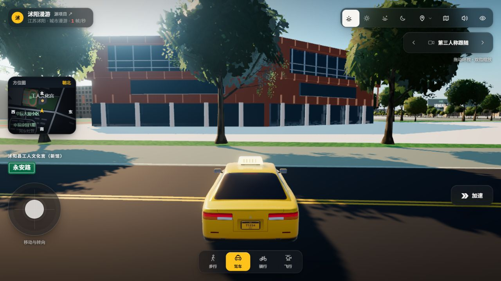
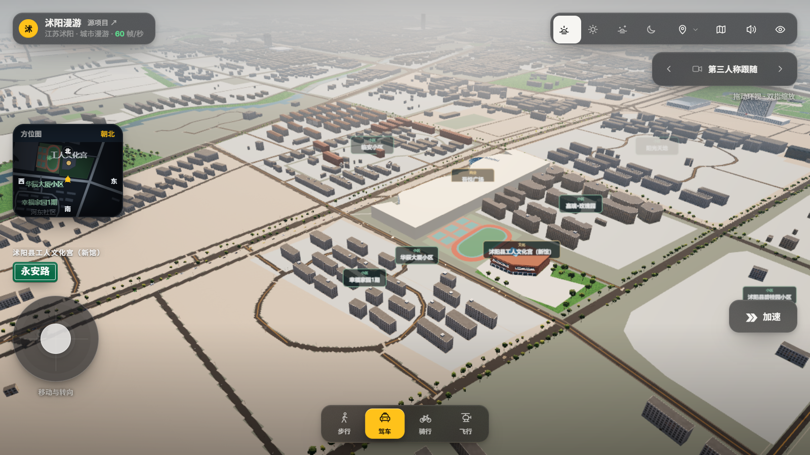
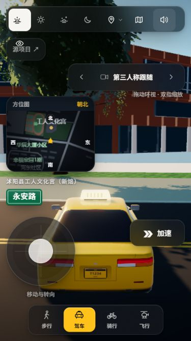
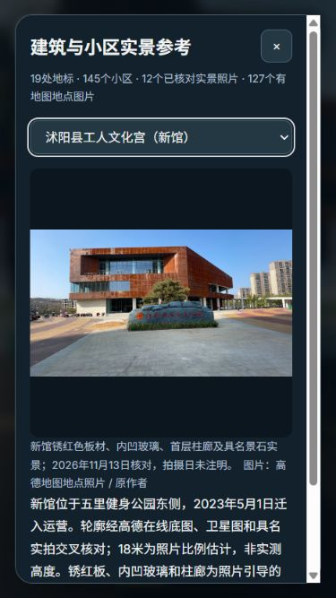

# 高德在线图层、吾悦南侧与新工人文化宫验收

2026-11-13。接续[嘉瑞/五里运动场批次](../wuyue-east-2026-11-13/README.md)，继续补实际缺楼，不代表城区还原已完成。

- 成功使用高德官方JS API标准地图与卫星图，保存视图范围及公开地点信息。图层拍摄日未知，2026版权/查询时间不作为拍摄年。
- 新增工人文化宫新馆1条、幸福家园北部片区20条完整可见建筑近似轮廓。保留旧7,558条及此前61条补录，当前7,640条：OSM 1,425、Overture 6,133、人工影像/在线补录82。普通楼体7,619条，专用模型替换20条、完全覆盖1条、部分裁剪13条、失败0。
- 华辰大厦小区沿永安路条带与幸福家园1期内街分开标名，两个近似范围不是正式小区红线，边缘楼栋未强行归属。当前145小区关联3,107条记录。12个小区已核对具名实拍，4处入口模型、8处门址仍未定位。
- 新工人文化宫按具名实拍重建锈红色板材、穿孔板、内凹玻璃与首层圆柱。屋顶板阵列按卫星可辨矩形定位，前广场按可见铺地勾绘并扣除楼体/道路。18米高度及未拍到的立面尺寸为估计，不是测绘复原。没有放置未定位景石，也没有把临时活动拱门当永久建筑。
- 新增第19处传送和两张署名参考图；所有原传送保留。原图在外链参考面板展示，不贴入可再分发的建筑纹理。

## 实际画面

最终默认机位完整原生截图，包含中文名称、小地图与加速按钮：

总览为实际运行页面截图，临时核对机位已恢复。南侧已补20条楼体，**华辰沿街高层和西侧君临天下的明显空缺仍待补齐**：

手机375×667原生界面与实景面板：

华辰和幸福家园各自的照片与说明见[华辰](huachen-gallery-mobile-native.jpg)、[幸福家园](happiness-gallery-mobile-native.jpg)。它们的门址未定位，未生成猜测门楼。

## 来源与坐标

- [江苏工人报2025-02-28报道](https://mobile.epaper.routeryun.com/index.php/home/article/index/appkey/4/date/2025-02-28/aid/8745727.html)确认新馆于2023-05-01迁入现址运营，证明它是旧2021影像之后的新设施。
- [高德新馆地点B0JG3A0FKP](https://www.amap.com/place/B0JG3A0FKP)提供可读馆名及外观实拍；原图拍摄日未注明。
- [华辰B0FFGA227J](https://www.amap.com/place/B0FFGA227J)、[幸福家园B020F0IH5Y](https://www.amap.com/place/B020F0IH5Y)与1期地点B0L2G6QZ6S交叉核对位置；排除高墟镇同名幸福家园。
- 君临天下B020F158TN两张可读题名入口图已查看；另一个候选是异地夜景，不进入已核对参考。尚未据此补整区楼群。

`online-district-traces.json` 保留完整轮廓原像素与选取方法，`map-view-observations.json` 保存GCJ-02视图边界。原生1536×1100图的地图页头为100像素；按Web Mercator插值后反算WGS84，再转项目统一米制坐标。浅色连通轮廓仅作辅助，已经逐块目视核对，截断形状被排除。原始截图/研究照片留在忽略目录，不含凭据。

Windows缩放导致本次CDP手机截图裁切与CSS视口不一致，验收以完整原生手机JPEG和DOM尺寸为准；CDP手机PNG保留为故障证据，不认作产品横向溢出。参考图描摹使用的是此前已核对像素尺寸的原生地图图，不混用CDP坐标。

## 验证

- [256项Node测试](node-tests.txt)通过；Windows未运行原有7项POSIX shell专用Overpass测试。[2项Python编码测试](python-tests.txt)通过。
- [运行核对](runtime-audit.json)：20栋新住宅全部向下射线命中实际SurveyedBuildingChunk屋顶；新馆命中18.22米屋顶，前广场命中0.25米铺地，广场内公园树点0。高度是展示估计，不据此认定真实楼高。
- 19处汽车落点均通过现有全车体安全解析且不在水中。普通楼体裁剪无失败；原始来源保留。
- [用地审计](urban-audit.json)：145小区、3,107条关联记录，铺地与楼体最大交叠0平方米；生成索引与压缩数据哈希一致。
- 手机面板宽324像素，内部纵向滚动，没有横向溢出；小地图、加速和出行切换都在375×667屏内，详见[面板](mobile-gallery.json)、[控件](mobile-hud.json)。实际切换加速开/关后恢复关闭。
- 最终默认机位、默认视口、默认缓存设置已恢复，照片面板关闭。[正常重新加载后的控制台](console-errors.json)没有错误。

一次手动直接调用渲染器的截图实验触发MRT着色器校验错误并产生黑图，不能作为画面证据；黑图已删除，错误保留在[capture-experiment-errors.json](capture-experiment-errors.json)。恢复正常动画渲染并重新加载后未复现，最终截图使用原生页面/正常渲染。后台帧率不作为性能结论。

## 仍需继续

华辰沿街高层、幸福家园剩余片区、君临天下和碧桂园等楼群仍缺；当前20栋住宅的高度、坡顶细节和单栋外立面未逐栋证实。新馆广场真实铺装图案、景石位置、东侧廊架仍待核对。虞姬公园塔桥、南湖园内建筑与设施、高中礼堂和校园楼体对应等完整目标继续保留，见[持续进度](../../BUILDING_REFINEMENT_PROGRESS.md)。
