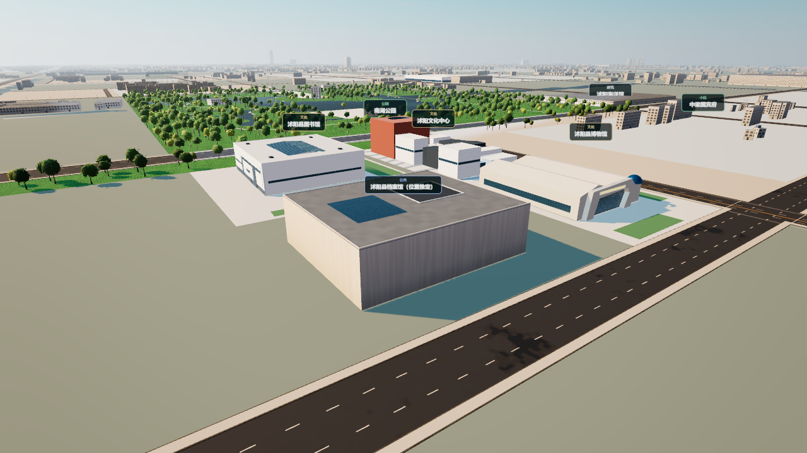
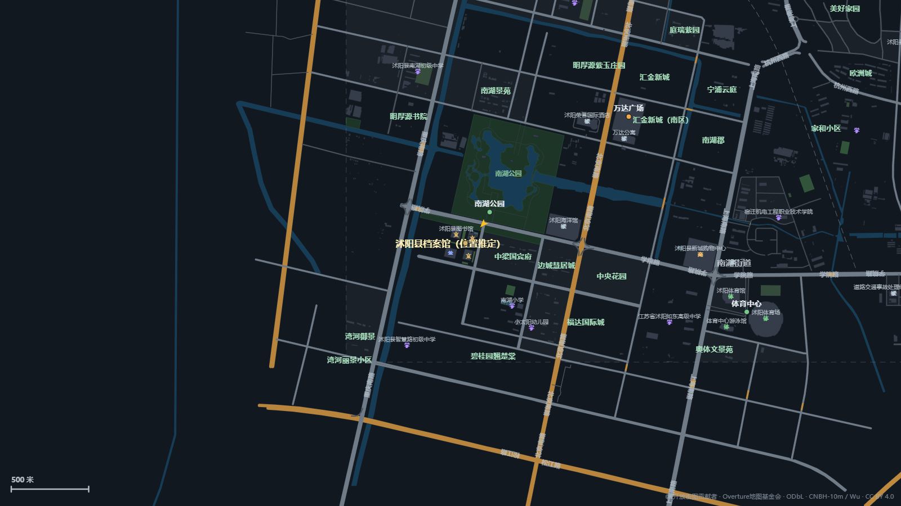

# 文化片区独立建筑补录 · 2026-11-15

图书馆南侧、博物馆西侧新增一栋卫星可见楼体，名称保留“沭阳县档案馆（位置推定）”。身份由政府相对地址支持，街面照片尚未绑定。仅细化影像可见采光面、暗色屋面区和低女儿墙；20米为类型估高，地面立面通用。已排除检索中误关联的广州学校照片。详见[研究与限制](../../../tools/data/shuyang/archives-roof-research-20261115.md)。

## 验证

- 378项Node与2项Python测试通过，日志随目录保存；7项需要Bash的既有Overpass用例未运行，不计入通过数。
- [来源保留审计](source-append-audit.json)：原7741条来源全部字段不变、原7741条解码后压缩几何记录不变，仅追加一条来源。引入版本化ID顺序表防止旧索引移动。当前7742条来源、7745个地图部件。
- [地理字段审计](geodata-append-audit.json)列出变动字段，原7744个地图建筑部件保持一致，仅追加一个；道路、步道等独立字段保持一致。
- 新增测试覆盖顺序表、旧记录前缀、身份与时点限制、屋顶区位、楼体保留、随机屋顶设备避让及道路/步道保留。道路1104个way、1105渲染分段、92条步道不变。
- [实际运行审计](runtime-audit.json)：WebGPU实际合并网格检查无非有限顶点；新增来源不在替换/完全覆盖/裁切列表。原楼体射线顶高20.22米，采光面20.255米、暗色区20.24米，屋顶边缘最高20.57米，均在20.6米预留以内。检查的是合并后的网格，元数据空分组不当作几何通过依据。
- 地图搜索“档案馆”返回带“位置推定”的名称。临时相机覆盖在结束检查时恢复。
- 检查过程中一次针对整场景的调试射线未配置Sprite相机，产生一条调试错误；改为仅探测实际Mesh后成功。该错误来自验收脚本，未修改应用运行代码，不以其宣称控制台零错误。

全城逐栋现状还原仍未完成。新楼精确高度、外立面、入口、地面边界及影像采集日期继续待核实。
