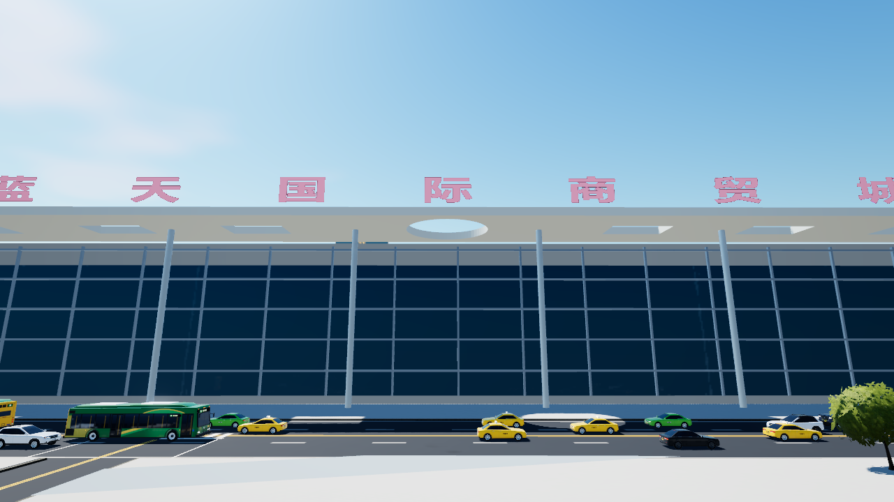
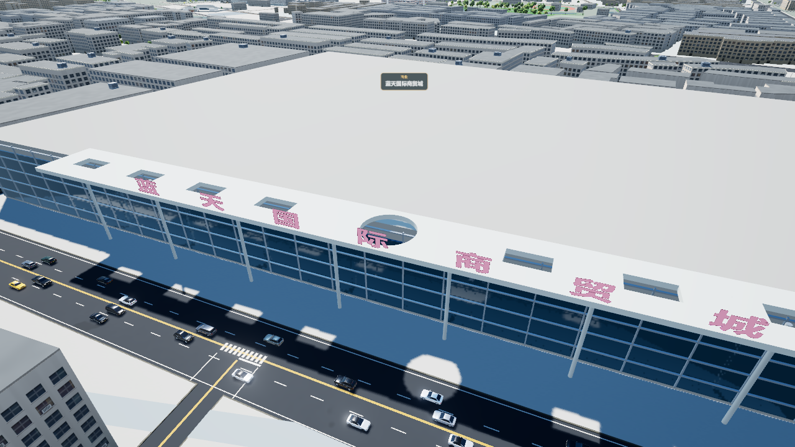

# 蓝天商贸城镂空门架 · 2026-11-15

按本次实际查看的京东拍卖具名实拍，去掉遮住圆洞的叠层顶板，改为单层实体门架，补圆洞、矩形天窗、细银柱和粉色题字。撤去未可靠定位的额外桁架、穹顶、屋顶设备和广告牌。[研究记录与证据限制](../../../tools/data/shuyang/bluesky-canopy-research-20261115.md)区分了照片可见特征与展示估计。

## 实际验证

- 395项Node与2项Python通过，日志随目录保存；7项需Bash的Overpass测试未运行，不计入通过数。
- 新增5项检查覆盖来源ID/稳定索引、来源高度与展示高度分离、9个孔洞互斥及轮廓包含、碰撞多边形、柱位避开全部已有机动车道与证据限制。
- [来源与几何审计](geometry-source-audit.json)：相对`00efad2`，生成地理数据（规范化LF）、建筑二进制及全来源文件不变。7742条建筑、7745个地图部件、1104条道路way、1105渲染分段及92条步道保留。门架外沿面积3328平方米，实际开口合计466.17平方米，均为展示尺寸。
- [浏览器运行审计](runtime-audit.json)：实际WebGPU中门架所属组的15个最终Mesh、9844个顶点全部有限。9个开口中心向上/向下射线均无顶板命中；实体样点分别命中顶27.4米、底26.2米，确认不是贴图假洞或上方另有盖板。屋盖碰撞包含相同9洞，8柱有碰撞；来源楼体保留7705个渲染记录，来源替换仍为既有绑定，裁切失败0。
- 实际浏览器核对近地与俯视画面，最终版本控制台错误记录0。结束时恢复临时相机和缓存设置，关闭预览页。未进行全城逐栋视觉验收或本批全移动端玩法回归。

## 仍未完成

洞口/柱子数量、位置、尺寸、高度和南向展示面均为估计，未定位精确入口；图片拍摄日未知。保留的来源大四边形可能包含场地，整座市场的实际屋顶轮廓与完整侧背面尚未重建；未新增28层塔楼。人民东路检索资料主要是改造效果图，没有用于建成街道现状。本批是门架细化，不代表整个核心城区或所有建筑道路已经还原。
