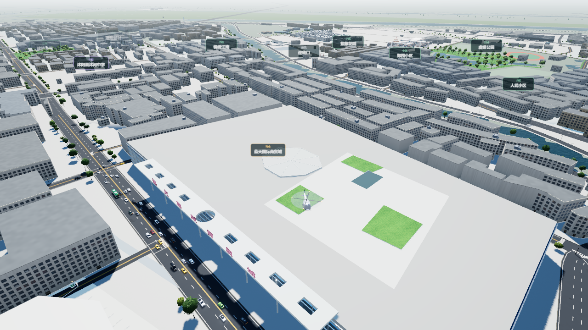
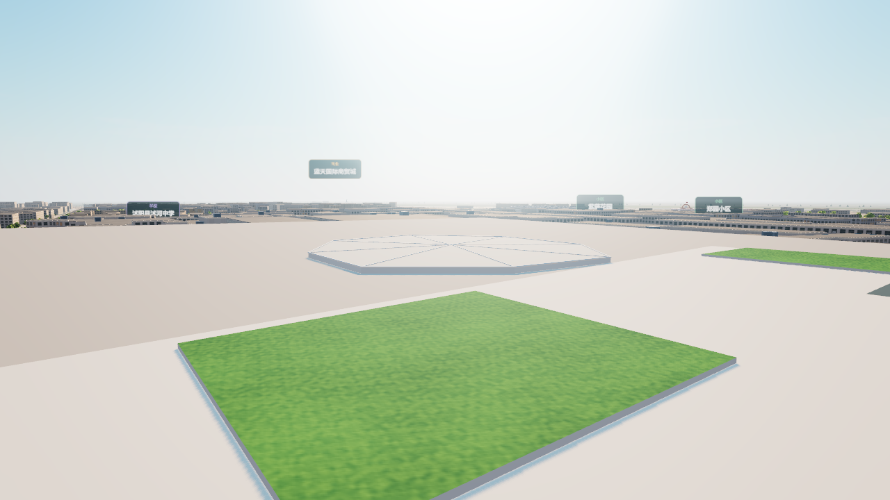
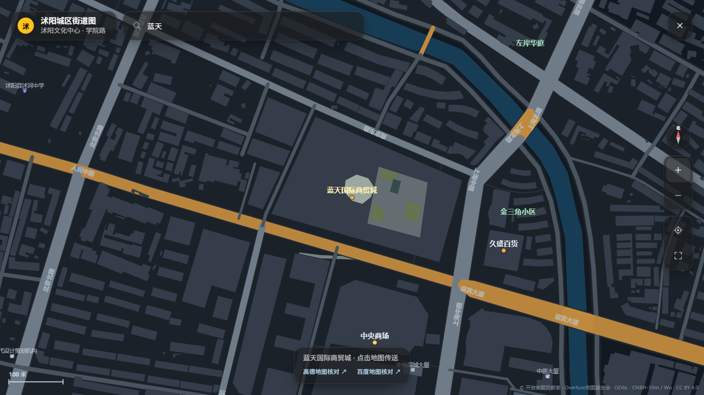

# 蓝天楼顶与人民中路历史参考 · 2026-11-15

按已校正的卫星像素位置，补蓝天商贸城低多边形采光面、东侧屋顶铺面、三块近似绿化区及深色矩形面，地图共用相同平面。原来源和25米展示主体保留；没有把屋顶露台切成地面庭院。新增人民中路路名牌/商圈路口历史实拍参考，未据此修改路宽或车道。详见[来源与限制](../../../tools/data/shuyang/bluesky-roof-research-20261115.md)。

## 实际检查

- 402项Node、2项Python通过，日志随目录保存。7项依赖Bash的Overpass测试未运行，不计入通过数。
- 新增7项检查覆盖来源ID/稳定索引和高度、屋顶描图包含关系、绿地与深色面互斥、铺面面积守恒、多边形顶面朝上/侧壁朝外、所有有限顶点与高度范围、描图摘要/未知日期和历史道路来源绑定。
- [来源与几何审计](geometry-source-audit.json)：相对`35cb47a`，生成地理数据（规范化LF）、建筑二进制和全来源文件不变。原7742条建筑、7745个地图部件、1104条道路way、1105渲染分段、92条步道保留。描图屋面约2111平方米、露台约10143平方米、三块绿化约2016平方米，均为近似展示面积。
- [实际WebGPU审计](runtime-audit.json)：屋顶专用材质最终合并为6个网格、1239个顶点，全部有限；包围盒最高约26.66米。采光面、三块绿化和深色面向下射线分别命中对应高度。三个主体样点仍命中25.22米原屋顶，且地面高度仍有原主体碰撞；源楼体渲染7705，裁切失败0。新增屋顶碰撞仅从25.22米开始，采光面采用26.7米保守上包络，未新增地面围挡。
- 实际浏览器检查整体、近景和地图检索；最终重载后控制台错误记录0，相机与缓存临时覆盖已恢复。未做全城逐栋视觉验收、夜景灯光或全移动端玩法回归；本批没有新增灯光。
- [图库加载元数据](gallery-audit.json)：两张历史参考分别加载为1276×597和1276×740；保留2022发表及拍摄日未知说明，不打包第三方原图或含原图的图库截图。

## 未完成范围

八点描图不代表真实边数已确认，采光面材质、坡度和所有高度未测绘；深色矩形未认作水池。三块绿化是本批展示分区，未核实树种、实际树位、设施总数或公众通行。整座市场的真实楼体/完整屋顶轮廓、门位、28层塔楼和侧背面仍待核实。人民路历史近景背后楼体、相邻道路标签、各段断面、路口和沿街设施继续核对。本批不表示全部核心城区建筑与道路已完成。
