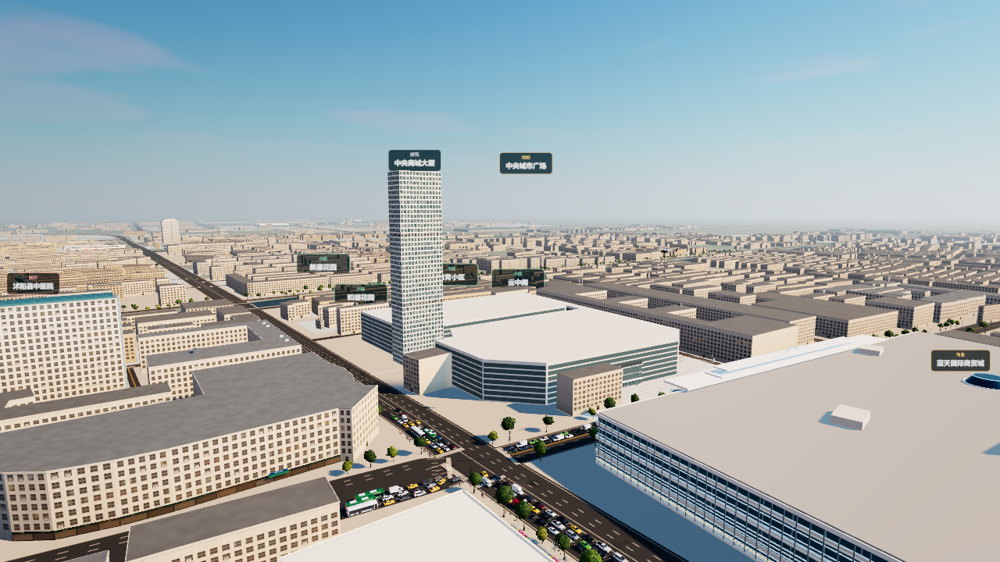
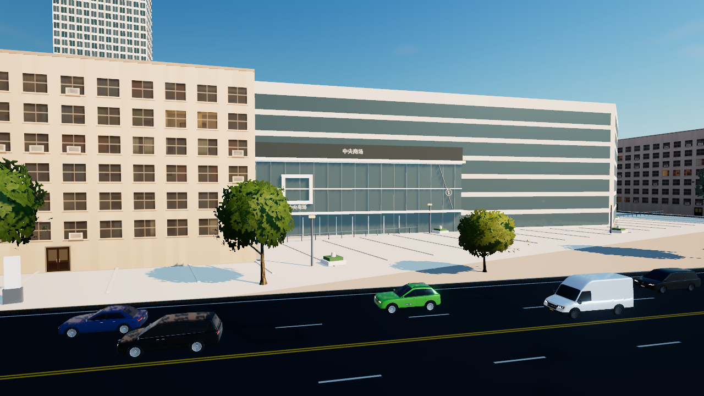

# 中央商场主塔与有限入口段 · 2026-11-15

按消防原图和2025开业近景，校准中央商场主塔的浅框/暖灰竖板/成对窗格及14、29层深色带，撤去缺乏证据的额外冠部，展示楼体回到报道147.15米。北侧有限入口段补空心矩形、浅门线、雨棚、细斜杆和圈号①；修正把朝北内街边误当北侧外沿的问题。主塔屋顶未被完整实拍核实，其他裙房立面仍通用，详见[研究与限制](../../../tools/data/shuyang/central-plaza-research-20261115.md)。

## 验证

- 390项Node与2项Python通过；日志随目录保存。既有7项Overpass用例需要Bash，本机未运行，不计入通过数。
- 新增6项测试覆盖来源绑定、150米来源与147.15米展示分离、42层窗口范围、两层避难带、实际生成面片顶高/有限坐标/朝外绕序、北侧外沿选择及浅入口；蓝天商贸城继续独立构建，没有重复旧中央商场模型。
- [来源审计](geometry-source-audit.json)：建筑二进制、全来源文件和生成地理数据与`dce2a66`逐字节一致。原7742条建筑、7745个地图部件、1104道路way、1105渲染分段、92条步道保留。展示楼体顶高含0.22米地面偏移为147.37米，旧代码最高点为171.7米。
- [实际运行审计](runtime-audit.json)：最终WebGPU合并后的11个网格、22104个顶点全部有限，实体屋顶射线和包围盒顶高均约147.37米，碰撞顶高一致。来源替换只保留既有2793/2795绑定，楼体渲染数7705不变；不是只检查留下的空元数据组。入口画面在外沿修正后重新取得，文字背景已改为局部镂空，避免在玻璃上多出黑色矩形。临时相机与缓存覆盖在检查结束时恢复。
- [图库加载审计](gallery-audit.json)：两张消防原图在实际图库中分别加载为600×338和600×383；只保存加载元数据，不打包第三方原图。最终重载后的控制台未记录错误。

精确层高、窗格、朝向、门位和未拍摄楼顶仍有估计。该批不是整个商场全部立面或整个核心商圈已还原完成。
