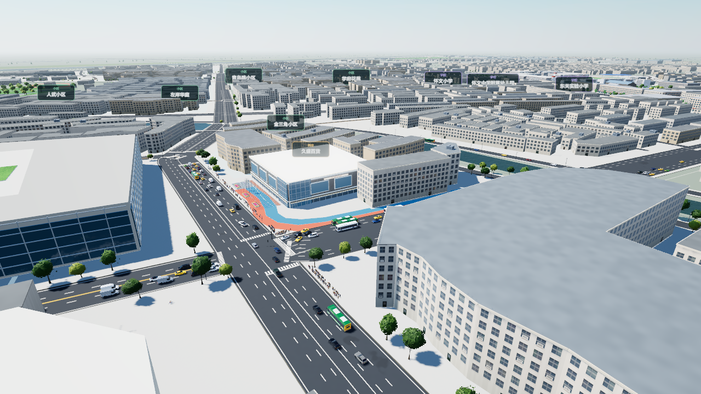
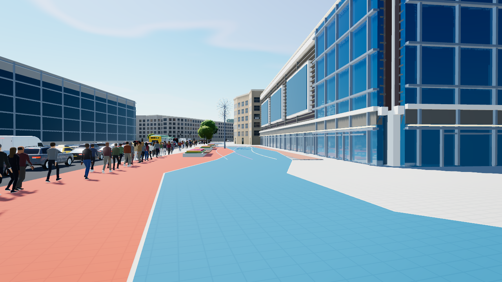
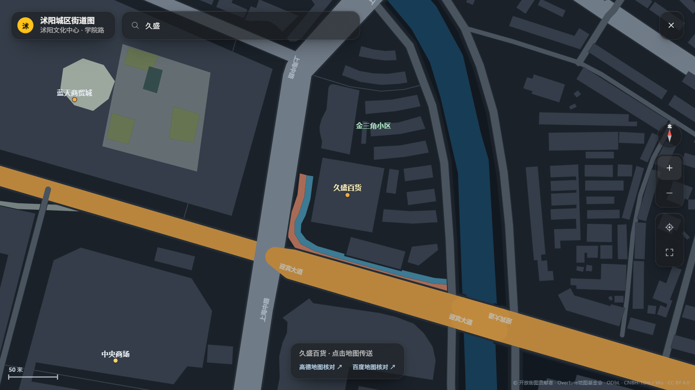

# 核心商圈路口东北角铺装 · 2026-11-15

按2022年速新闻实拍样式与校正卫星位置，补蓝色、红褐色沿街铺装和细接缝。用实际道路三角形及建筑缓冲裁切，保留独立南侧店铺排楼；地图、树位避让和步行/骑行/AI行人高度共用相同多边形。[研究记录](../../../tools/data/shuyang/core-junction-frontage-research-20261115.md)保留原始像素、来源及未核实项。

## 验证结果

- 410项Node、2项Python通过；7项需Bash的Overpass测试未运行，不计入通过数。新增8项检查包括来源保留、真实道路带避让、相邻独立楼体、面域互斥/面积、树位与地面高度、AI落脚、玩家/自行车/汽车分离及未知日期/描图摘要。
- [来源和几何审计](geometry-source-audit.json)：相对`2a6acd6`，生成地理数据（规范化LF）、建筑二进制及全来源文件不变，7742来源建筑、7745地图部件、1104道路way、1105渲染分段、92条步道保留。两色带原始描图约3195平方米，冲突裁去约688平方米，剩余蓝色约1334、红褐色约1173平方米；颜色接缝在蓝带内部，无重复面域。生成工具重运行结果一致。
- [实际WebGPU审计](runtime-audit.json)：最终3个网格、366顶点全部有限且朝上；三种材质样点射线均命中0.33米，步行/骑行查询一致，汽车仍返回0米车行地面。实际树场在色带及0.65米缓冲内冲突0，7个通用候选树位被避让。源建筑仍渲染7705条，裁切失败0。
- [实际步行](walk-audit.json)：角色从蓝带安全点向北移动约0.495米，开始/结束高度均0.33米，结束仍在铺装内。临时角色、模式、相机与缓存已恢复，存储模式回到原car；预览页关闭。最终应用控制台无错误记录。
- 实际浏览器核对整体、近地画面及地图检索“久盛”后色带位置。未执行全城逐栋视觉验收、夜景灯光或全移动端玩法回归；本批无新增灯光或交通规则。

## 限制与后续

照片发表于2022年，拍摄日未知；卫星采集日亦未知。色带曲线、宽度、砖模块及0.33米高度都是展示估计，不认作法定自行车道/跑道或2026现状。不凭广角图改变路名、车道、斑马线、信号相位、商户或建筑。完整路口断面、其余方向、人行入口及邻近逐栋立面仍在核对，不能据此标整条路或核心城区完成。
