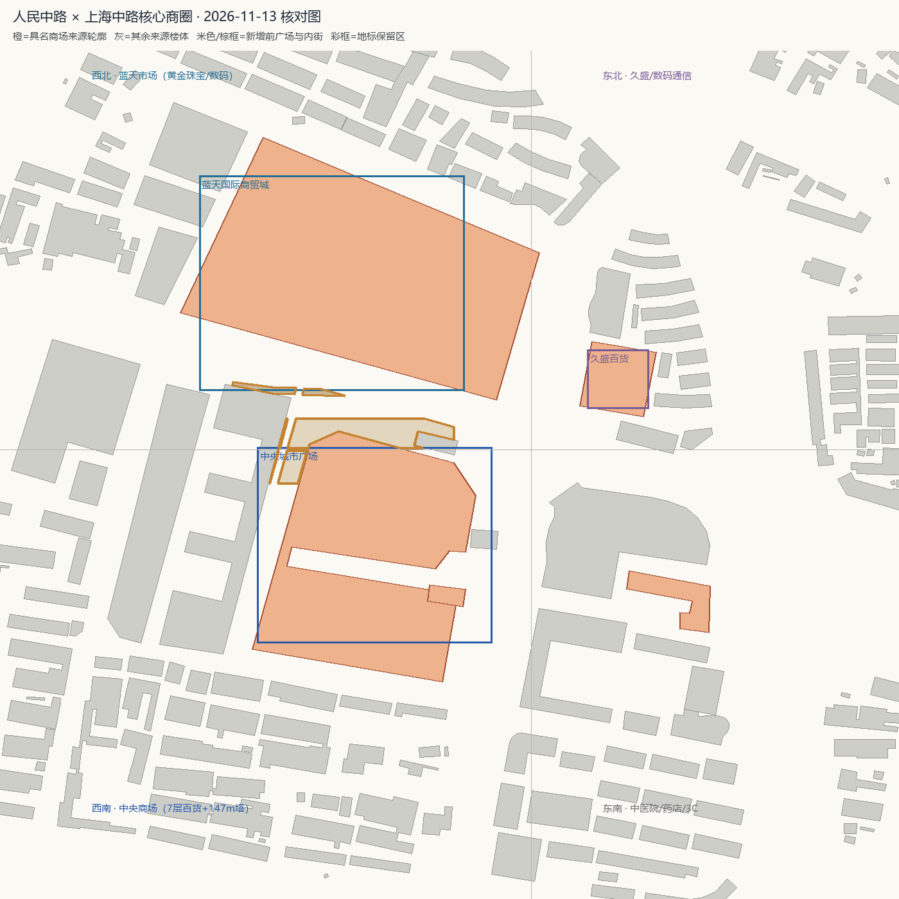

# 人民中路 × 上海中路核心商圈细化验收

2026-11-13。接续实验小学校区批次，按用户要求转向"蓝天市场＋中央商场"这一片核心商圈。保留前批全部成果。

## 范围与消歧

项目世界原点就在**人民中路 × 上海中路**交叉口。网络资料确认十字路口四角的商业格局：

- 西北角：**蓝天国际商贸城**（本地俗称蓝天市场），黄金珠宝、数码通信店集中；
- 西南角：**中央城市广场 / 沭阳中央商场**（雨润中央广场），7 层百货＋42 层公寓塔的综合体；
- 东北角：香港久盛百货、沭阳商业大厦、移动营业厅与数码通信；
- 东南角：沭阳县中医院、欧中广场，药店与 3C 数码集中。

## 网络核对来源

| 来源 | 用途 | 时间 |
| --- | --- | --- |
| [高德官方 zoom-18 标准图＋卫星图](https://www.amap.com/)（本地拼接，仅目视核对） | 四角 POI 面、商场轮廓、楼号、内街、前广场、屋顶中庭与长阴影 | 2026-11-13 查询，图层拍摄日未公开 |
| [雨润中央广场百科](https://baike.baidu.com/item/%E6%B2%AD%E9%98%B3%E5%8E%BF%E9%9B%A8%E6%B6%A6%E4%B8%AD%E5%A4%AE%E5%B9%BF%E5%9C%BA/16849837) | 西南角；占地 61743㎡、建面 316574㎡；3# 楼 150m/42 层；7 层百货＋3 层内外街；一期 2 幢 31 层商住楼、二期 5 幢 32 层住宅；2017-03 竣工 | 词条更新至 2024 |
| [联商网：沭阳中央商场开业](https://m.linkshop.com/news/show.aspx?id=432899) / [中央商场集团开业图文](https://mp.weixin.qq.com/s/JSk22haArOurWb9eddYE6Q) | 32 万方、地上七层/地下两层、1936 街区、42 层地标公寓 | 开业报道 |
| [中央商场官网：京东折扣超市开业](https://www.njzysc.com/new_1_9e0aca90b0dc4490b5e919c84a5de186.html) | 入口实景：深灰玻璃幕墙、白色横框、顶部广告带、斜向钢桁架、红色圆标；舞狮与充气拱门为临时设施 | 2025-08-30 |
| [蓝天国际商贸城司法评估报告](https://filegy.rmfysszc.gov.cn/2022/1020/B0244830DBA7825D978D2A52A75BFF6B/E879296BA895502C0B7BCFA637F969B9/%e6%b2%ad%e9%98%b3%e8%93%9d%e5%a4%a9%e5%95%86%e8%b4%b8(1).pdf) | F1 区 -2+28 层；外墙玻璃幕＋贴砖、断桥铝窗；四至东临上海路、南临人民中路、西临沈阳路、北临南京东路 | 2022-10-20 |
| [2026 年商圈现场观察（三石说沭阳）](https://m.toutiao.com/article/7635874027835376147/) | 四角业态分布、一楼临街几无空铺、二三楼有空铺招租 | 2026-05-04 |
| [新华日报：沭阳打造重要支点城市](https://zgjssw.jschina.com.cn/shixianchuanzhen/suqian/202407/t20240710_8355875.shtml) | 蓝天商贸城附近小吃一条街与夜市、中央商场等载体运营提升 | 2024-07-10 |
| [沭阳县十四五规划纲要](http://www.shuyang.gov.cn/shuyang/file/zgsyadmin/eWebEditor/uploadfile/20210323121627769.pdf) | 官方明确"重点推进中央商场、蓝天商贸城等载体运营提升" | 2021-03 |
| [2023 消防主塔实拍](https://www.ourjiangsu.com/a/20230419/1681913718712.shtml) / [蓝天京东拍卖入口实拍](https://paimai.jd.com/detailUnaudit/309846413) | 既有地标实景参考（前批已接入） | 2023 / 拍卖公告 |

## 核对结论

- 把 2026-11-13 图层与项目来源轮廓叠加：**四角共 672 条来源记录（±700 m）**，大商场主体、周边商铺与住宅的二维轮廓基本对齐；自动互相关校准得到 x=-5 px / y=+5 px（约 3 m，IoU 0.399），小于单栋判读误差，未额外平移。
- **高度明显低估**：核心区 ≥35 m 的来源楼体只有 1 条（中央商城大厦 150 m，OSM 标签）。百科/司法评估提到的 2 幢 31 层商住楼、二期 32 层住宅、蓝天 F1 区 28 层塔楼，在来源表里都只有 17~26 m 的 CNBH 估高或没有可绑定的独立轮廓。卫星图西南象限可见高层长阴影，但不能把某一长条屋顶可靠绑定到"31 层"这一数字。
- 因此本批**不新增来源楼体、不静默改写高度、不虚构高层体量**，7,728 条来源（OSM 1,425 / Overture 6,133 / 补录 170）保持不变；细化放在立面、铺地、店招和已有 147.15 m 主塔上。

图为项目自身数据绘制，不含在线底图瓦片或第三方照片。

## 本批实际变化

- 新增独立图框 `amap-core-retail-20261113`（3328×2816，GCJ-02 瓦片格网）。
- 新增 `js/core-retail.js`，在既有两大商场主体**之上**叠加细节，不重复 `sourceBody`。首轮用 0.2–0.3 m 薄片线条，在 147 m 塔与 200 m 商场的尺度下远看会被吃掉；本轮改为 **1 m 级实体构件**，优先改变轮廓与体量：
  - **中央商场裙房**：7 层各挑出 0.55 m 厚、约 1 m 的实体檐板（偶数层再加 1.75 m 深遮阳板）与檐下暖光灯带；每 8 m 一道 1.4 m 宽、1.1 m 凸出的石材竖翼；北侧临人民中路入口做成突出 8.7 m 的深灰玻璃门厅、10.5 m 悬挑雨棚、两侧实体斜钢桁架、发光门楣与"中央商场"灯箱；入口前台阶、石墩与红色圆标。
  - **中央商场屋顶**：整体屋面板、8 组 3–5.6 m 高设备房、3 条屋顶绿化带、3 条玻璃采光天窗与白色压顶。
  - **147.15 m 主塔**：每面每 6 m 一道 1.5 m 宽、0.95 m 凸出的竖向石翼（分三段通高）；5 道 2 m 挑出的避难层檐口与发光边；三层退台、机房、13 m 钢桅杆、三层航空障碍灯。
  - **蓝天市场**：玻璃幕外挂每层 3 道 1.35 m 深横向遮阳百叶、4.2 m 间距竖梃、1.5 m 厚贴砖横带；南侧宽门架改为**上下双层实体构架＋斜腹杆**，圆洞加发光环；8 根 0.5–0.62 m 银柱与柱帽；5 块带发光背板的**类别店招**（黄金珠宝/数码通信/眼镜钟表/通信服务），不复刻品牌与现租户；屋顶设备群、46×7.4 m 广告框架、玻璃穹顶与发光环。
- 新增 2 处前广场铺地（中央商场人民路前广场、蓝天市场人民路前广场）与 2 段内部通路（中央商街内街、蓝天小吃街）。铺地已扣除来源楼体，**最大交叠 0 ㎡**；`imageAcquired` 均为 null。中央商街内街落在既有 OSM 人行铺地内，生成时被吸收，未重复盖面。
- 两处前广场补街道家具：石框树池、5.4 m 路灯、暖光导视灯箱、铺装石带与护栏；传送落点从 170–195 m 拉近到 **110 / 120 m**，近景细节不再被距离吃掉。
- 更新 `js/landmark-references.js` 的 central / bluesky 说明，写入 2025 入口实景、2022 评估层数、2026 业态观察与"未绑定高层不建模"的限制。
- `index.html` 补新模块预加载；新增 `tests/core-retail.test.mjs`（3 项，含模块级加载回归）。

## 验证结果

- 关键子集 **26 项全通过**：core-retail（3）、teleports、boot、landmark-sources、reviewed-district、shiyan-campus。本轮全量测试在 Overpass 网络用例上长时间阻塞被中止，未取得完整数字；上一轮完整全量为 276 项 / 271 通过 / 5 项 Windows 既有 POSIX 失败，[node-tests.txt](node-tests.txt) 保留该完整日志。本轮以子集结果为准，不把上一轮数字冒充为最新全量。
- Python 中文编码测试 **2 项通过**，见 [python-tests.txt](python-tests.txt)。
- 生成链 7 个脚本按序重跑成功；`plaza` 5→7、`community-path` 13→15、`reviewedSurfaces` 35→39。新地表与来源楼体最大交叠 0 ㎡，见 [data-audit.json](data-audit.json)。
- 本环境无头 Chrome / Edge 均无法启动，**没有新的原生 3D 截图**；画面通过本地预览 `http://127.0.0.1:8123/?tp=central`（中央商场）或 `?tp=bluesky`（蓝天市场）直接查看。

## 仍需核实

- 在线图层与官网照片均未公开拍摄日；查询日不等于影像年份。中央商场官网图片域名存在证书域名不匹配，仅作本地研究，未加入可再分发的参考面板。
- 31/32 层住宅、蓝天 F1 区 28 层塔楼的精确轮廓、位置与实测高度仍未绑定；本批没有把它们建为新增体量。若后续取得可定位的正面实拍或竣工图，可再单独补建并保存原估高为历史参考。
- 主塔退台、屋顶机房、采光中庭、门架立柱数量、店招文字均为类型化展示估计，不是测绘复原；2026 业态只用于决定店招类别，不代表当前具体租户。
- 东南角中医院、东北角久盛百货与商业大厦沿用现有来源与既有专用模型，未做逐栋外立面更新。
