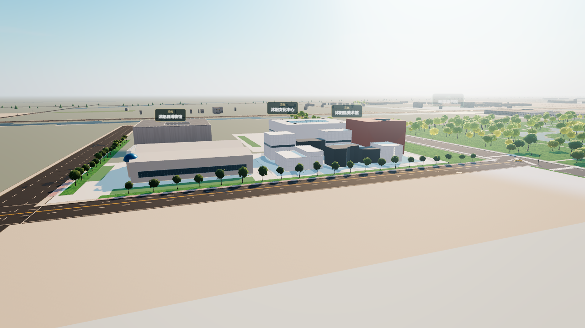
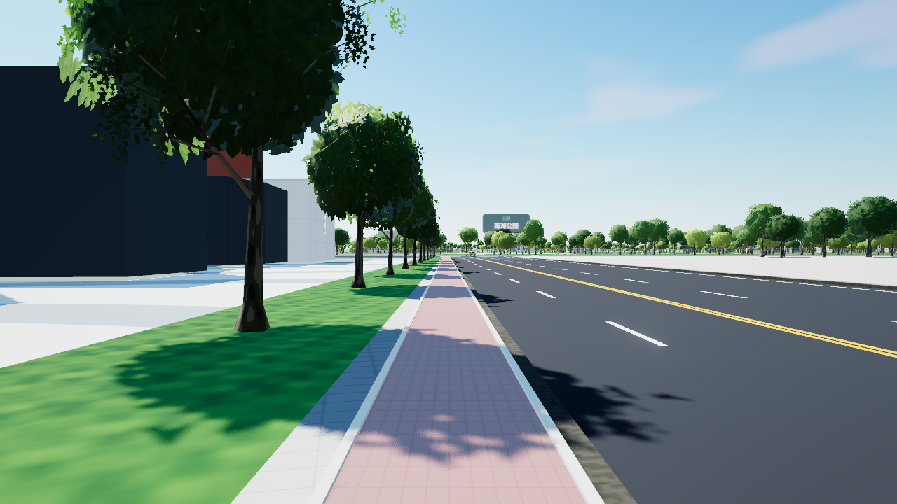
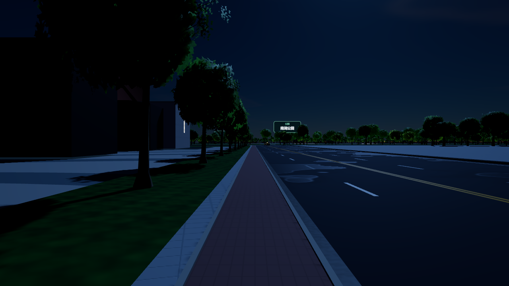
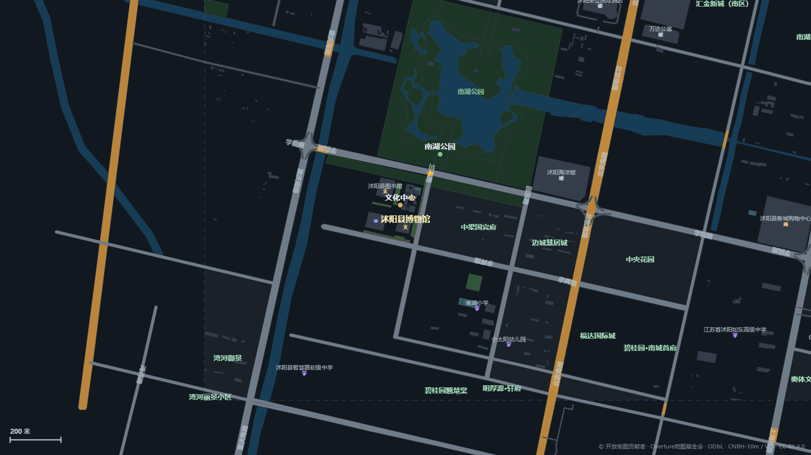

# 兰亭路与承晖路沿街细化 · 2026-11-15

按设计方提供的馆群建成摄影及已核对卫星图，细化兰亭路西侧、承晖路北侧两段窄步行带、绿带和低路缘；补带抗锯齿砖缝的红褐色铺地，37株示意行道树均经实际树场接受。两馆前场和美术馆波纹铺地同步扣除新条带，地图共用几何。详见[照片依据、定位与限制](../../../tools/data/shuyang/cultural-streets-research-20261115.md)。

## 验证

- 384项Node、2项Python测试通过，日志随目录保存。既有7项Overpass用例需要Bash，未运行且不计入通过数。
- 新增6项测试覆盖路面三角形/实际楼体避让、铺装绿带互斥、旧馆前铺地退让、树位去重与避障、来源文件保留、部分街段证据范围。
- [来源与几何审计](geometry-source-audit.json)：与`885735b`相比，全建筑来源文件、建筑二进制和生成地理数据逐字节相同；7742条建筑来源、7745个地图部件、1104道路way、1105渲染道路分段、92条步道不变。生成器重复运行得到相同输出。
- [运行审计](runtime-audit.json)：实际WebGPU合并为3个网格、168个顶点，非有限坐标0。两条街各取步行带/路缘/绿带一个点，六点射线分别命中0.255/0.29/0.245米，全部通过。37个选择树位全部在最终`treeField.sites`中，不以候选数代替实际种植。
- 预览曾使用旧街道模块缓存，强制无缓存重载后重新取得全部运行结果和下方画面。检查中一次把树场Set当作数组的调试脚本失败，随后改为按实际Set读取；不以此宣称本轮检查过程零调试错误。临时相机及缓存覆盖在结束检查时恢复。

旧照片拍摄日与卫星采集日未知。树距、树种、砖模块和路缘高度为展示估计，没有校正车道断面或核实全部出入口。此批只登记部分沿街界面，城区逐栋、逐路段目标继续保留。
