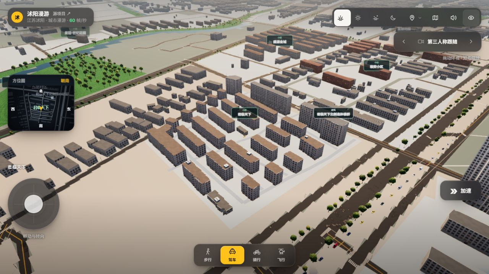
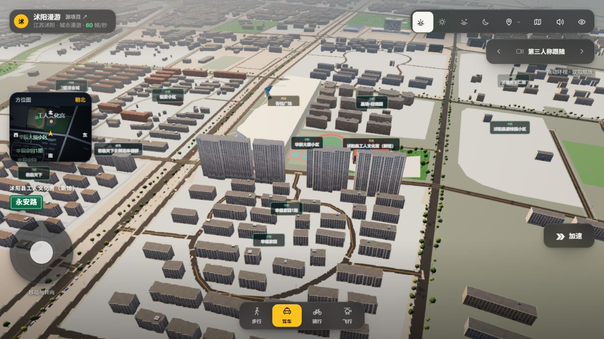
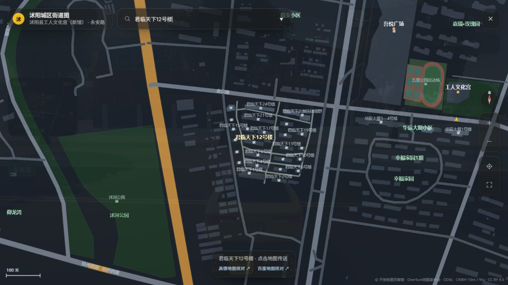
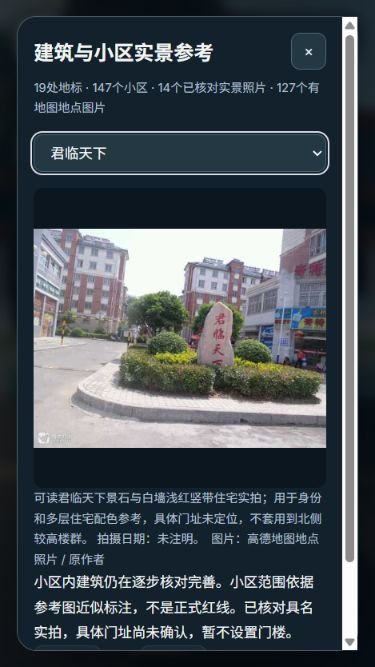

# 君临天下、幸福家园与华辰沿街补录

2026-11-13。接续[在线地图与新馆批次](../amap-south-2026-11-13/README.md)。本批有楼体、道路和标注的实际增量，全城逐栋还原仍未完成。

- 74个完整轮廓候选中接受54个，20个与前批幸福家园轮廓重叠而保留旧记录。新增君临27条、幸福家园24条、华辰3条完整底图轮廓。建筑来源共7,694条，原7,558条保留，人工补录136条。
- 君临27条包含24个可明确对应楼号的轮廓、1组北侧相接范围、2处附属建筑；不能把来源条数直接当作实际独立栋数。保留中文楼号并加入地图搜索。
- 华辰3条底图轮廓显示为四个高层体块。西侧相接范围保留低连接部，两段上部体块依据楼号与卫星影像区分。78米、8米连接部和核心分界均为展示估计，楼层数未知，不是测绘结果。
- 华辰2号楼旧Overture片段仍在数据中，绑定到完整新轮廓的同一专用模型。新轮廓约覆盖旧片段85%；生成器只允许明确列出的局部来源绑定，并检查覆盖至少80%、面积大于原片段两倍。地理数据生成前还须验证新旧ID均绑定到同一模型，不能泛化放行普通重叠。
- 幸福家园主区与原先较小的1期近似范围分别保留，不把全区都称为1期。147个具名小区范围关联3,161条记录；14个范围有已核对照片，主区/一期共用身份参考图，4处入口模型，10个范围门址尚未定位。
- 按地图中可辨线路补7段君临内部通行路，三维与地图同源；4.5米宽度是估计，铺装扣除建筑、已有道路等，不据此认定通行权或真实道路规格。
- 小地图优先小区和道路，楼号保留在搜索、放大地图与近距离三维标注中；搜索具体楼号会自动放大。避免新增楼号挤满方位图。

## 实际画面

临时核对机位下的实际运行页面截图；机位与玩家位置随后恢复。

地图中实际搜索12号楼，保留高德/百度核对入口：

手机375×667实景面板：

华辰估高说明见[手机截图](huachen-gallery-mobile-native.jpg)，小地图与操作区见[手机场景](mobile-scene-native.jpg)。原生JPEG是本批主要截图证据，未用重绘图替代运行画面。

## 来源与精度

高德官方在线图层查询于2026-11-13，未公开拍摄日期，不能称为2026年拍摄。`map-view-observations.json` 保留17.5级视图、1536×1000地图尺寸、GCJ-02边界；原生截图页头100像素。`online-district-traces.json` 新参考使用自己的范围转换，不能套用前批视图坐标。

先保留有楼号的原图，再临时隐藏标注获得无文字遮挡轮廓。浅色连通分量只辅助选取，每个完整外沿均与有标注图、卫星图交叉查看；截断和不完整候选未采用。Web Mercator插值后反算WGS84，再转统一米制，仍有底图精度和人工判断误差。

- [君临天下B020F158TN](https://www.amap.com/place/B020F158TN)：可读景石题名、白墙浅红竖带住宅实拍。照片仅用于身份与多层住宅配色，不统一套用到北侧较高楼群。具体门址未知，不放置猜测门楼；异地夜景候选未采用。
- [华辰B0FFGA227J](https://www.amap.com/place/B0FFGA227J)：具名门楼；门楼照片不能证明四栋高层的精确高度。
- [五里运动场B0FFKG8M39](https://www.amap.com/place/B0FFKG8M39)：可见沿街高层的外观实拍，与卫星楼群位置交叉核对；拍摄日未注明。
- [幸福家园B020F0IH5Y](https://www.amap.com/place/B020F0IH5Y)：台州南路94号具名入口，排除高墟镇等同名地点。

照片在外链参考面板署名展示，未作为建筑纹理再分发。原始研究图在忽略目录中，已保存公开资料不含凭据；本批临时地图页和凭据代理均已关闭。

## 检查

- [257项Node测试](node-tests.txt)通过；原有7项POSIX shell专用Overpass测试未在Windows运行。[2项Python编码测试](python-tests.txt)通过。
- [运行核对](runtime-audit.json)包含51处普通楼体、4个高层、1处低连接部与7处内部路面，共63个探测点，均命中预期实体。高层78.22米、连接部8.22米包含地面0.22米偏移，仍是估计高度。
- 普通楼体实际7,669条，专用模型明确替换24条来源记录、完全覆盖1条，部分裁剪13条，无裁剪失败；19处汽车传送均找到干燥且全车体检查通过的落点。
- [用地审计](urban-audit.json)：147个具名范围、3,161条关联记录，路面/铺地与建筑最大交叠0平方米。生成器同时检查建筑提取哈希及旧局部来源的模型绑定。
- 手机实景照片实际加载，面板324像素宽且无横向溢出，内部纵向滚动；小地图、加速与出行切换在屏内。见[面板](mobile-gallery.json)、[控件](mobile-hud.json)。
- 正常加载后的[控制台记录](console-errors.json)、最终机位与视口恢复状态另存。后台帧率不作为性能结论。

## 继续完善

本批主要补完整平面与高度层次，普通住宅立面仍是近似。复杂/凹轮廓的坡顶显示仍不完整，数据中的gabled标记不能当作已重建真实坡面；应优先继续改善可确认的屋顶、阳台和实际街景材质。北侧相接楼群的分栋、华辰精确高度、院内附属设施、绿化、入口位置仍待核对。

新世界商业广场、碧桂园及其他邻近片区仍有缺楼；嘉瑞遮挡/旧轮廓冲突、虞姬公园塔桥、南湖园内设施、高中礼堂及校园楼体对应等完整目标继续保留，见[持续进度](../../BUILDING_REFINEMENT_PROGRESS.md)。
