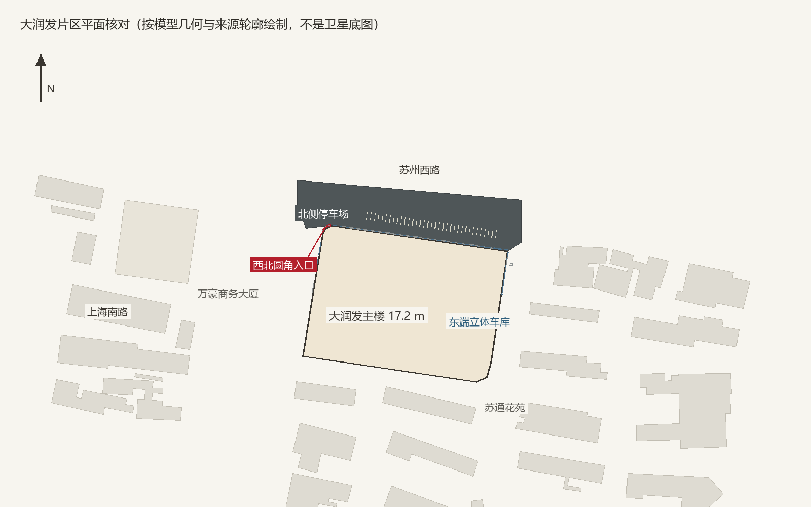
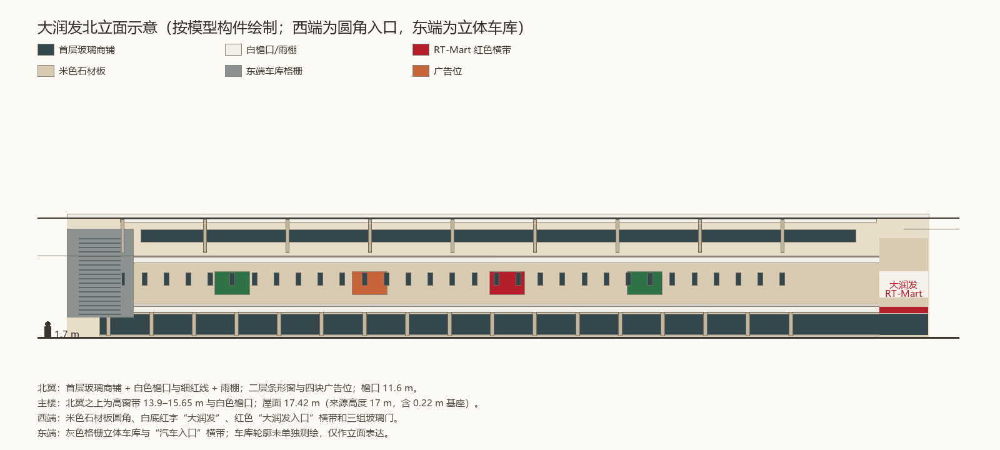

# 大润发北立面与北侧停车场验收

2026-11-13。范围是上海南路与苏州西路交汇处东南角的大润发（沭阳店）：北到苏州西路，西到上海南路，东到苏通花苑西侧车道。本批只细化这一片，不扩展到梦溪中学、沃德嘉园或吾悦。

## 结论

- **不新增建筑来源**：7,728 条保持不变。大润发仍绑定 OSM `way/497798167`，普通楼体不会在模型内重复生成；周边苏通花苑、万豪商务大厦的来源轮廓也未改。
- **改正立面朝向**：旧模型把白灰/橙色横带、圆弧转角和招牌放在西侧与西南角，实际主立面朝北（苏州西路），西北角才是 2009 照片中的圆弧转角。本批把细节全部转到北立面。
- **改用现状外观**：2009-12-13 历史照片记录的是白灰墙面、橙色横带旧外观；2024-12 高德地点评论照片显示外墙已改为米色石材板、白底红字“大润发”门头和红色“大润发入口”横带。本批以后者为现状依据，旧照只用于体量、窗带和转角关系。
- **新增专用模型** `js/rtmart-district.js`：北翼两层商铺、白色檐口与雨棚、广告位、条形窗、主楼高窗、西北米色圆角入口、东端立体车库格栅与岗亭、屋顶空调机组与天窗、北侧停车位划线。`js/photo-landmarks.js` 中的旧大润发块已移除，避免两套几何叠加。
- **新增核对地表** `reviewed/rtmart/north-forecourt`（停车/沥青，5190.4 m²），来源为 2026-11-13 高德 zoom-18 瓦片；影像拍摄日未公开，`imageAcquired` 为 `null`。
- **更新实景参考**：2024-12 地点照片、2009 历史照片、东端立体车库入口照片，共三张；说明照片日期不确定，不把查询日当拍摄日。
- **调整传送落点**：`?tp=rtmart` 与传送菜单现在落在苏州西路上、面向北立面（原落点在上海南路西侧，只能看到服务面）。落点仍在道路上，不进入停车场或建筑内部。

## 依据与日期

| 依据 | 能确认的内容 | 不能推定的部分 |
| --- | --- | --- |
| 2009-12-13 历史照片（图内日期，2015 转载） | 北立面两层商铺、白色檐口、深色条形窗、橙/白广告位、西北圆弧转角、红色“RT-Mart 欢迎光临”横带 | 不是现状；橙色横带已在后续改造中消失 |
| 2024-12 高德地点评论图（文件名时间戳 1735270050887） | 米色石材板、白底红字“大润发”门头、红色“大润发入口 ENTRANCE TO RT-MART”横带、三组玻璃门、两侧促销海报、右侧黑色格栅屏 | 拍摄日未另行注明；只覆盖入口附近，不能证明整圈外墙都已改造 |
| 百度百科 / 大润发官网 | 2009 年开业，4.8 万 m²，一、二层营业；南门上海南路 208 号，北门苏州西路 173 号；B 馆 2 楼有苏宁易购 | 不能用建筑面积反推层高或单栋实测高度 |
| 2024-02 公开报道 | 大润发对 10 年以上门店做 2.0 重装，计划约 90 家 | 报道没有点名沭阳店；只能作为米色门头出现的时间背景，不作为本店已改造的直接证据 |
| 2026-11-13 高德 zoom-18 卫星/标准图 | 北侧连续沥青停车场、东端灰色立体车库、屋顶机组与天窗、东北角圆形设施 | 拍摄日未知；18 级影像无法分辨门头文字和细部 |
| 高德 POI `B0H64UJ5QP` / 车库入口照片 | 东端“立体停车场”名称、灰色格栅、红色“汽车入口”横带、岗亭和道闸 | 车库轮廓未单独测绘；照片拍摄日未注明 |

公开页面：[大润发沭阳店](https://www.amap.com/place/B020F0IFW9)、[立体停车场](https://www.amap.com/place/B0H64UJ5QP)、[大润发官网门店页](https://www.rt-mart.com/stores/store-info?storeId=1071)、[百度百科](https://baike.baidu.com/item/%E6%B2%AD%E9%98%B3%E5%A4%A7%E6%B6%A6%E5%8F%91%E8%B6%85%E5%B8%82/10921558)。

## 模型与精度

- 主体按来源轮廓 17.2 m 挤出（CNBH 17 m + 0.22 m 基座），屋面加浅灰盖板与女儿墙压顶。北翼是 11.6 m 的两层前檐，不另造第二个体块；主楼墙身高窗带 13.9–15.65 m 露在北翼之上。
- 西北圆角用两条来源立面线的半径 5 m 圆角，曲面比来源切角最远凸出 0.87 m；这是为了让曲面可见的展示估计，不是实测半径。入口门头、红色横带、三组玻璃门、两块促销板都布在这个曲面上。
- 东端立体车库只做东、北立面的灰色格栅与“汽车入口”横带，未单独测绘轮廓。入口位置参考高德出入口点 `(-59.6, 1640)`，岗亭和道闸为类型化构件，`collide:false`，不阻断车道。
- 屋顶 8 组空调机组、2 条天窗、35 格停车位划线为展示性数量；卫星只能确认“有设备和车位”，不能确认台数或车位编号。
- 北侧停车场 5190.4 m²，边界按卫星像素勾绘；车位线与实际车位不对应，不应当作停车管理数据。
- 模型构件全部 `collide:false`，碰撞仍由来源轮廓承担；没有把檐口、雨棚、格栅或岗亭加进地面碰撞。

## 检查

- 285 项 Node 测试中 280 项通过；5 项失败全部是既有 `overpass.test.mjs` 依赖 POSIX shell 临时文件清理的用例，Windows 上无法运行，与本批无关。本批新增 4 项回归测试全部通过。
- 2 项 Python 中文编码测试通过。
- 模型审计：39 个盒体、11 组实例、22 个网格；与相邻来源建筑最大交叠 0 m²；35 条停车位划线全部落在核对地表内；圆角凸出来源轮廓 0.87 m；没有新增建筑记录。
- 按生成链重跑 7 个脚本：7,728 条来源不变，170 条人工补录不变；21 处地标与 21 个传送按钮保持一致；新地表 `imageAcquired:null`。
- 环境限制：本机无头 Chrome 无法启动，**没有取得原生 3D 浏览器截图**。`rtmart-plan.png` 与 `rtmart-north-elevation.png` 是按 `js/rtmart-district.js` 实际构件几何绘制的核对图，不是浏览器画面，也不是卫星底图。

## 仍未核实

1. 2024-12 照片只覆盖西北入口；北翼东段、东端车库、南门（上海南路 208 号）和西侧服务面的现状仍缺逐段照片。模型为统一材质把米色用于整圈外墙，但只有西北入口有照片依据；东、南、西侧的同色处理是展示假设，未逐面核实。
2. 圆角半径、北翼下檐深度、主楼高窗高度、屋顶机组数量为展示估计；没有单栋实测层高或设备清单。
3. 东端立体车库的独立轮廓、层数、坡道位置和出入口车道宽度未测绘；当前只是立面表达，可能与该建筑实际体量不符。
4. 北侧停车场的车位数量、无障碍车位、装卸区、岗亭位置和收费道闸未核对；35 格划线仅为示意。
5. 2009 照片中的“RT-Mart 欢迎光临”红色连续横带是否仍存在于北翼东段未确认；当前只保留细红线和入口横带，避免把旧外观当现状。
6. 南门、B 馆、苏宁易购入口、肯德基等内部/沿街业态未单独建模；不把地点评论中的临时海报、清洁车、隔离栏建成永久设施。
