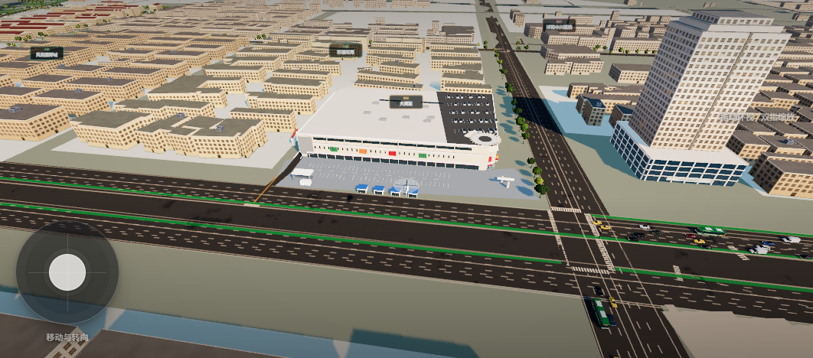
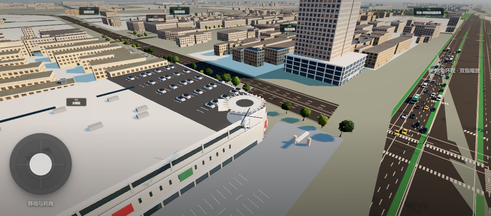
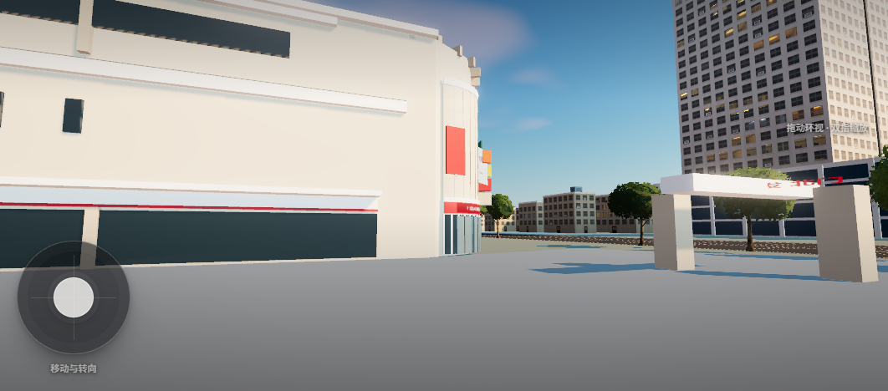
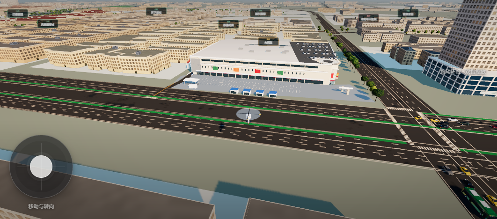
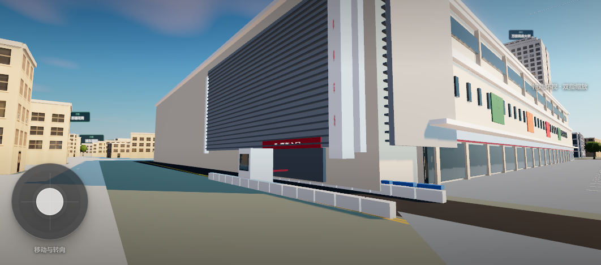
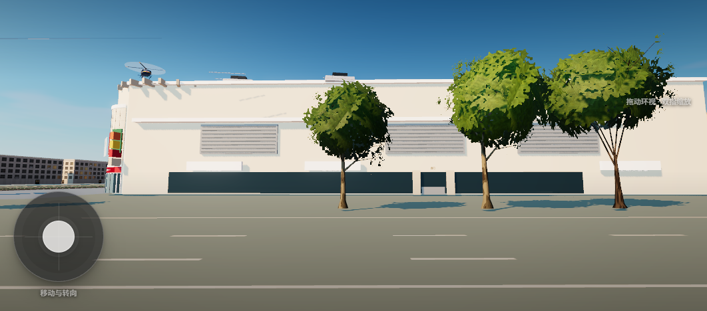
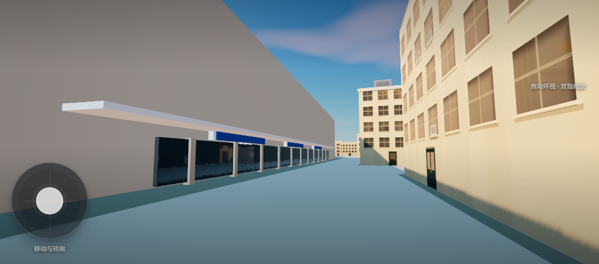

# 大润发本体与周边建筑道路细化验收（第二轮）

2026-11-14。范围是上海南路与苏州西路交汇处东南角的大润发（沭阳店）本体、北侧前场、东端立体车库、西侧/南侧沿街面，以及紧邻的苏通花苑西门与周边道路设施。本批在 2026-11-13 批次（北立面/前场）基础上补全其余立面与周边道路细节，不扩展到梦溪中学、沃德嘉园或吾悦。

## 结论

- **不新增、不删除建筑来源**：7,741 条保持不变，人工补录 183 条不变；大润发仍绑定 OSM `way/497798167`，普通楼体不会在模型内重复生成；周边苏通花苑、万豪商务大厦的来源轮廓也未改。楼体数据未动，未重跑建筑生成链。
- **确认立体车库在东端**：高德 POI「大润发沭阳店立体停车场(出入口)」（`B0H64UJZIM`）落在楼体东缘 `(-59.6, 1640)`；苏通花苑地点照片把「胡记水饺(沭阳二店)」（注册地苏通花园34幢115室，地图标注苏州西路近大润发）与灰色格栅车库、竖向「立体停车场」灯箱、红色「汽车入口」横带拍进同一画面。本批把竖向灯箱、蓝白水马、黄色引道标线补进东端车库表达，并维持 11-13 批次的东端落位（不采信 POI 本体锚点 `(-208, 1694)` 的偏移落位）。
- **补出西屋面停车层与螺旋坡道口**：zoom-18 卫星可见楼体西半屋面为深色沥青停车面（成排车位线与车辆），西北角有约 18-20 m 直径的环形坡道口；东半为浅色卷材屋面与空调机组。本批用裁剪轮廓的屋面板 + 车位线 + 实例化车辆 + 环形坡道表达，**停车层标高沿用来源挤出 17.2 m（展示假设，未实测）**。
- **补全西、南立面与前场业态**：依据高德标准图标注补西侧（肯德基/蜜雪冰城/好必和大食堂 + 西门）、南侧（罗莱家纺/开心城堡儿童乐园/自然堂 + 蓝色招牌带 + 白色雨棚）、北侧前场（小淮娘鸭血粉丝等蓝棚小吃亭、收货区雨棚与货车、北门门楼）；店招文字来自地图标注，不是逐块实拍的招牌复刻。
- **苏通花苑西门入模**：`community-data.js` 中该小区由「无门址参考」升级为 `sutongWest` 门楼模型（灰色门柱横梁、金色题名、门房），门址钉在 `way/1321791101` 西边界与东侧服务车道交点 `(-44.6, 1650)`（约 25 m 级近似，满足既有「边界折线上」护栏）。
- **周边道路设施**：苏州西路南侧两座「大润发北」站棚、上海南路东侧「大润发西」站棚（依据高德站位标注与百度百科站名清单），东侧服务车道沿线实例化路边停车（卫星可见）。

## 依据与日期

| 依据 | 能确认的内容 | 不能推定的部分 |
| --- | --- | --- |
| 2024-12 高德地点评论图（`B020F0IFW9`，文件名时间戳 1735270050887） | 米色石材板、白底红字「大润发」门头、红色「大润发入口 ENTRANCE TO RT-MART」横带、玻璃门、两块促销板、左侧彩色竖条板、右端黑色格栅 | 拍摄日未另行注明；只覆盖西北入口附近 |
| 2026-11 高德街景（苏通花苑 `B020F0IJ7U` 地点图 ×3、立体停车场 `B0H64UJ5QP`） | 东端灰色格栅、红色「汽车入口」横带、竖向「立体停车场」灯箱、岗亭道闸、蓝白水马、黄线；苏通花苑西门（金色题名、门柱、门房）与胡记水饺(苏通花园34幢)同框 | 照片拍摄日未注明；车库独立轮廓/层数/坡道仍未测绘 |
| 2026-11-13 高德 zoom-18 卫星/标准图（`amap-rtmart-20261113`） | 北侧连续前场与车位、蓝棚小吃排、东北收货区、西半屋面停车层（车位线+车辆）、西北环形坡道口、东半屋面设备、南侧雨棚与蓝色招牌带、东侧服务车道与路边停车、苏州西路绿化带与公交站 | 影像拍摄日未公开；18 级影像不能分辨门头文字 |
| 高德 POI 标注（标准图） | 北门/西门/东北门/收货区/西1门；苏宁易购、必胜客(N多寿司)、蜜雪冰城、肯德基、好必和大食堂、自然堂、罗莱家纺、开心城堡儿童乐园、小淮娘鸭血粉丝的点位 | 标注是点位与业态，不是逐块招牌样式或立面实测 |
| 胡记水饺(沭阳二店)工商/地图信息（顺企网、360地图） | 苏通花园34幢115室、苏州西路近大润发、电话 0527-80816677 —— 用于把车库照片定位到东端服务车道 | 34 幢与具体来源轮廓的逐栋对应未做 |
| 百度百科 / 大润发官网（2026-11-14 复核） | 2009 开业、4.8 万 m²、一至二层营业；南门上海南路208号、北门苏州西路173号；公交站「大润发/大润发北/大润发西」与线路；苏宁易购(B馆2楼)、肯德基(一楼)等业态 | 不能用面积反推层高；公交站棚样式未实拍 |

公开页面：[大润发沭阳店](https://www.amap.com/place/B020F0IFW9)、[立体停车场](https://www.amap.com/place/B0H64UJ5QP)、[苏通花苑](https://www.amap.com/place/B020F0IJ7U)、[大润发官网门店页](https://www.rt-mart.com/stores/store-info?storeId=1071)、[百度百科](https://baike.baidu.com/item/%E6%B2%AD%E9%98%B3%E5%A4%A7%E6%B6%A6%E5%8F%91%E8%B6%85%E5%B8%82/10921558)、[胡记水饺(沭阳二店)](https://www.11467.com/suqian/co/31009.htm)。照片权利归原作者；高德查询时间不是影像拍摄时间。

## 模型与精度

- 主体仍按来源轮廓 17.2 m 挤出（CNBH 17 m + 0.22 m 基座），不替换来源轮廓；所有新增构件 `collide:false`，碰撞仍由来源轮廓承担。
- **西屋面停车层**：按来源轮廓在局部 x≤-26（楼体西半）裁出深色沥青面板，5 排车位线 + 约 30 辆实例化车辆；西北角 `(-177.8, 1620.3)` 处环形坡道口（26 段环道 + 栏板 + 井壁 + 引道板）。环径、井深、车辆数、**屋面标高=主体 17.2 m** 均为展示估计；卫星只能确认「有停车层与环形坡道」，不能确认层数或坡道通向。
- **东端立体车库**：沿用 11-13 批次格栅 + 「汽车入口」横带 + 岗亭道闸；本批新增竖向「立体停车场」灯箱（5 字竖排，白底红字）、双列蓝白水马、两侧黄色引道线。格栅范围、水马排数为展示估计。
- **西立面**：首层玻璃橱窗 + 三块业态招牌（肯德基/蜜雪冰城/好必和大食堂）+ 西门门柱与横批 + 上部三段百叶（停车裙楼表达，展示假设）；招牌文字取自地图标注，落位沿西缘参数近似排布。
- **南立面**：首层玻璃 + 3 块招牌（罗莱家纺/开心城堡儿童乐园/自然堂）+ 连续白色雨棚（2.4 m 挑出为估计）+ 蓝色招牌带 + 壁柱；对应卫星南缘蓝色招牌带与浅色雨棚。
- **北侧前场**：2 排 70 格车位线 + 车道虚线；4 座蓝棚小吃亭（鸭血粉丝/小吃/水饺/面馆为类型化店招，小淮娘为地图标注业态）；东北收货区雨棚 + 装卸台 + 货车；西北「大润发 北门」门楼。亭位、车位排数为展示估计。
- **彩色竖条板**：按 2024-12 照片左缘的橙/黄/红/深色叠条加在入口曲面西侧，宽度与条数为估计。
- **苏通花苑西门**（`js/community-entrances.js` 新增 `sutongWest` 分支）：门柱 1.7 m 方截面、横梁 1.15 m、红色上框与立柱、金色「苏通花苑」题名、白色门房（绿条腰线）；尺寸按照片估计，门址在边界折线上（测试护栏距离 <0.3 m 实测 0.005 m）。
- **公交站棚 ×3**：顶棚 4.7×1.75 m、玻璃背板、长凳、站名牌（大润发北×2、大润发西）；站位按高德站标近似落位，样式为类型化，不是沭阳实拍站棚。
- **服务车道停车**：东侧 4.5 m 服务车道沿线按卫星可见的路边停车布置约 20 辆实例化车辆（含车舱）。

## 截图

无头 Chrome（CDP + SwiftShader，1080×620，隐藏 HUD）原生截图：

## 检查

- Node 313 项中 308 项通过；5 项失败全部是既有 `overpass.test.mjs` 依赖 POSIX shell 的用例，Windows 无法运行，与本批无关。本批扩展 `tests/rtmart-district.test.mjs` 回归断言（屋面停车层/螺旋坡道/水马/南壁柱/站棚/业态与站名文字/实例组数），并更新 `tests/wode-mengxi.test.mjs` 的社区照片断言（苏通花苑由「无门址参考」改为「有实拍门址」，其余三小区保持 referenceOnly）。
- 2 项 Python 中文编码测试通过。
- 模型审计（`tools/audit-rtmart-district.py` → `data-audit.json`）：113 个盒体、23 组实例、44 个网格；与相邻来源建筑最大交叠 0 m²；70 条前场车位线全部落在核对地表内；圆角凸出来源轮廓 0.87 m；`sourceBodies:[17.2]`；**没有新增或删除建筑记录**（7,741 / 183 不变）。
- 本地预览：`python -m http.server 8123 --bind 127.0.0.1` + `http://127.0.0.1:8123/?tp=rtmart` 落在苏州西路、面向北立面；`?tp=rtmart` 落点不变。

## 仍未核实

1. 西屋面停车层的真实标高与结构（地上裙楼屋面 / 与主体同层 / 坡道通地下）未判定；当前按「与主体同高的屋面停车层」展示，螺旋坡道口为平环形表达。
2. 2024-12 照片只覆盖西北入口；北翼东段、南门（上海南路208号）现状仍缺逐段照片；整圈米色外墙仍是 11-13 批次的统一材质假设。
3. 东端立体车库的独立轮廓、层数、坡道与出入口车道宽度未测绘；水马、黄线数量为照片示意。
4. 西/南沿街业态招牌为地图标注的文字复刻，不是逐块实拍的招牌样式、尺寸与材质；好必和大食堂、罗莱家纺等的门头形式未核实。
5. 前场小吃亭、收货区雨棚/货车、北门门楼的尺寸与数量为展示估计；「小淮娘鸭血粉丝」等店名来自地图标注，未取得门头实拍。
6. 公交站棚样式未实拍（仅站位与站名有依据）；苏州西路中央绿化带与既有道路模块的一致性未逐米核对。
7. 苏通花苑西门门址为同框实拍 + 边界交点推定（约 25 m 级）；门房、门柱尺寸未实测，34 幢与来源轮廓未逐栋绑定。
