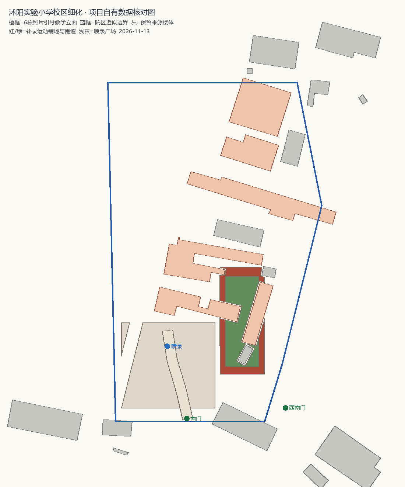
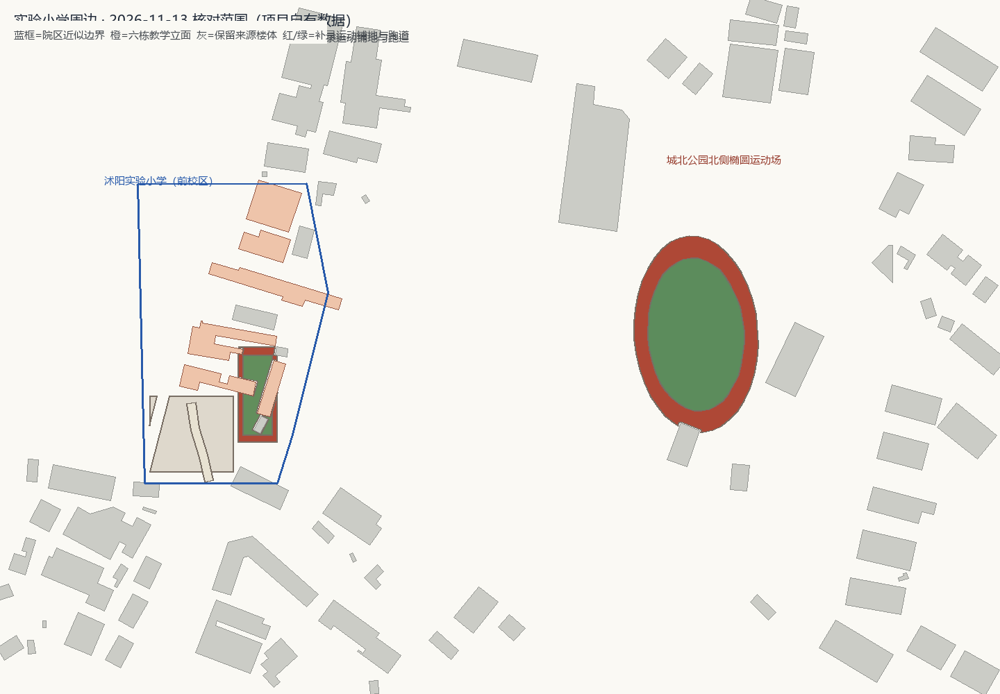

# 沭阳实验小学校区与周边细化验收

2026-11-13。本批按用户要求转向老城"实验小学"片区，目标是核对周围建筑物的现状布局、取得外观实拍，并做更细粒度的渲染。保留前批沃德嘉园—大润发—梦溪中学成果。

## 目标消歧

项目和网络资料里有多所名称含"实验小学"的学校（康平路第一实验小学、广州路实验小学、第二实验小学、东关实验小学、开发区实验小学等）。本批选择**公园路11号／公园西路128号的沭阳县实验小学（江苏省沭阳实验小学）前校区**，依据：

- 项目 `osm_pois.json` 有精确同名 POI `沭阳实验小学`（`way/1456634995`）与 `沭阳实验小学北区`；
- [2026年3月县政府声环境功能区文件](http://www.shuyang.gov.cn/shuyang/zfbwj/202603/443a71f18d6a4d6887897b1971a50d2a.shtml)把"沭阳实验小学片区"与"第一实验小学片区""深圳路实验小学片区"并列，说明"沭阳实验小学"是独立标准名称；
- 腾讯地图 POI 给出公园路11号 (34.13659, 118.776301) 及南门、西南门坐标；[百度百科](https://baike.baidu.com/item/%E6%B1%9F%E8%8B%8F%E7%9C%81%E6%B2%AD%E9%98%B3%E5%AE%9E%E9%AA%8C%E5%B0%8F%E5%AD%A6/9073778)给出公园西路128号、前/后/南三校区、约13.3万㎡、105个教学班。

公开资料中的公园路5号、11号、24号、128号是同一老城院区的历史门牌差异，未据此移动来源轮廓。城北公园（老虞姬公园）在校园东侧，与迎宾大道虞姬生态园分开。

## 网络核对到的现状与外观

| 来源 | 用途 | 时间说明 |
| --- | --- | --- |
| [高德官方 zoom-18 标准图 + 卫星图层](https://www.amap.com/)（本地拼接、仅目视核对） | 校园 POI 面、院内屋顶、南门/西南门、周边楼号（紫藤花园、政园小区、老实小安置小区、八一·文枢院）、城北公园北侧两处椭圆运动场 | 2026-11-13 查询，图层拍摄日未公开，不等于2026拍摄 |
| [学校 2026-10-16 校园特色文化展示图文](http://mp.weixin.qq.com/s?__biz=MzA3NDExMzI2MQ==&mid=2649571339&idx=1&sn=e7aa5d87ab1cab97c03b152a0d9037ca) / [转载页](https://www.yeyulingfeng.com/a/1199381.html) | 喷泉广场、带钟的橙粉弧形山墙、四层白色水平窗带、右侧顶部开放钢架塔楼、首层开敞走廊、竖排红字高主楼；文中提到后校区风雨操场 | 10月16日活动、10月17日转载；照片拍摄日未注明 |
| [沭阳发布 2026-10-25 校园特色展示汇总](https://finance.sina.com.cn/wm/2026-10-25/doc-iniwmhuv9902137.shtml) | 确认"沭阳县实验小学 AI启新程 美乐润童心"，与其余小学区分；提供与学校原文完全相同的喷泉广场照片镜像（`n.sinaimg.cn`），作为参考面板主图 | 2026-10-25 刊载 |
| [县政府 2026-05-29 六一走访报道](http://www.shuyang.gov.cn/shuyang/syyw/202606/c103fd2fc8cd4321a831998f04f12744.shtml) | 确认县实验小学仍在老城办学、有人工智能通识课等活动 | 2026-06 |
| [2024-11-06 速新闻百年校史专题](https://www.suxinwen.cn/wap/news/2289775) | 校训"百年文脉 知行合一"、袁公藤、百年老校背景 | 图文2022/2024，不推定为现状 |
| [县政府声环境功能区方案](http://www.shuyang.gov.cn/shuyang/zfbwj/202603/443a71f18d6a4d6887897b1971a50d2a.shtml) | 实验小学片区四至、周边学校名单 | 2026-03 |
| 腾讯地图 POI（公园路11号、南门、西南门） | 校门坐标与周边小区清单 | 查询日 2026-11-13 |

## 本批实际变化

**没有凭空补楼。** 把 2026 图层上的院区屋顶与项目已有 OSM/Overture 轮廓逐块叠加核对后，确认校园内可见屋顶均已有来源轮廓，院区周边 500 m 内已有 235 条来源记录且与标准图浅灰楼块基本对齐。因此本批不新增建筑来源，7,728 条来源（OSM 1,425、Overture 6,133、人工补录 170）保持不变。

- 新增独立图框 `amap-shiyan-core-20261113`（3328×2816，GCJ-02 瓦片格网，`mapOffset=[0,0]`）。用 OSM 水面掩膜自动校准：项目坐标投影到该图层的最佳平移为 x=-4 px、y=0 px（约2米），水面 IoU 0.588；该偏差小于单栋判读误差，未另作平移修正。
- **6 栋来源教学楼**绑定 `js/shiyan-campus.js` 专用立面：白灰四层水平窗带、橙粉色壁柱与檐带、玻璃窗、带钟的半圆山墙与旗杆、塔楼顶部开放钢架。其余院内来源楼体继续普通渲染，不挖空整校。18.0 m（含构架）／16.5 m 主体是照片类型估计，原 CNBH/raster 值保留在来源记录中。
- **校门与广场**：按腾讯南门/西南门坐标放置石材校名墙（"沭阳实验小学""百年文脉 知行合一"）、门柱、电动伸缩门、门卫室、两侧铁艺栏杆；喷泉按卫星可见位置建圆形水池、水柱。中央通道保持开放。
- **新增 5 个地表 + 1 段院内通路**（3D 与小地图同源）：喷泉广场铺地、东侧南北向运动铺装、东侧绿色内场、城北公园北侧完整椭圆红色跑道与绿色内场、校门中轴通路。所有铺地已扣除来源楼体，最大交叠 0 ㎡。跑道归属学校与道数未核实，名称中保留"归属未核实"。
- **新增第 21 处可传送地标** `shiyan` 与 3 张 2026 校园实拍参考（远程链接，不贴为建筑纹理、不随仓库分发原图）。
- 新增 `tests/shiyan-campus.test.mjs`（4 项，含模块级加载回归），并在 `index.html` 补齐新模块的预加载条目。

两张图均由**项目自身数据**（院区边界、来源轮廓、补录地表）绘制，不含在线底图瓦片或第三方照片。

## 验证结果

- Node 测试 **273 项、268 通过、5 失败**；5 项全部是 `overpass.test.mjs` 中依赖 POSIX shell 的临时文件清理用例，在 Windows 上既有失败，与本批无关。新增 4 项实验小学回归（含模块级加载）全部通过。详见 [node-tests.txt](node-tests.txt)。
- Python 中文编码测试 **2 项通过**，见 [python-tests.txt](python-tests.txt)。
- 浏览器加载仍沿用项目静态页；本环境无头 Chrome 与 Edge 均无法启动（两者都无输出、不产出截图），因此**没有生成新的原生 3D 截图**。作为替代，[data-audit.json](data-audit.json) 记录了生成链输出、传送落点、地表面积/交叠与坐标校准；本地部署 `python -m http.server 8123` 后通过 `http://127.0.0.1:8123/?tp=shiyan` 打开预览面板直接查看 3D 画面（新增 `?tp=` 深链自动传送）。此项限制如实保留，不用旧批次截图冒充本批成果。
- 新增地表与来源建筑最大交叠 0 ㎡；6 个新地表 `imageAcquired=null`，不误标为2021或2026拍摄。
- 传送 `shiyan` 落在公园西路侧道路上，距南门 40–200 m，干燥且指向校门；`LANDMARK_REFERENCES` 键集合与 21 处地标、`index.html` 的 21 个传送按钮一一对应。

## 仍需核实

- 高德在线图层与 2026 校园照片均未公开拍摄日；查询日不作为影像年份，不能认定这就是最新竣工状态。
- 前/后/南三校区中，本批只覆盖地图 POI 面与卫星可辨的前校区；"沭阳实验小学北区"、南校区和后校区风雨操场没有独立建模，也未把照片中的临时展板、机器人、活动横幅做成永久设施。
- 六栋教学楼与实拍每栋楼的精确对应、立面题字原文、楼层数、屋顶构架尺寸、校门宽度、围墙范围均未测绘；橙粉配色与构件是类型化重建。
- 城北公园北侧另一个椭圆跑道（西侧较暗的一处）本批未补；已补跑道的归属、道数、球场划线仍待核对。
- 周边紫藤花园、政园小区、老实小安置小区、八一·文枢院等楼群已核对布局，但逐栋外立面、坡顶、阳台和小区门址仍沿用现有来源与通用渲染。
- 学校展示图文的两张照片托管在第三方转载站 CDN，复核时该 CDN 曾返回 502；参考面板主图已改用沭阳发布/新浪财经的同一张照片镜像，另两张在个别网络下可能暂时不可达。研究用副本只保存在被忽略的 `tools/data/shuyang/reference/`，未作为建筑贴图或仓库资源分发。
