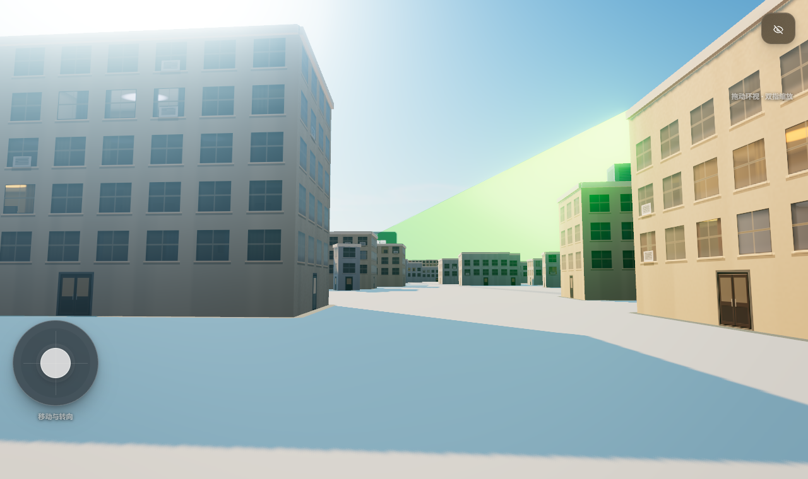
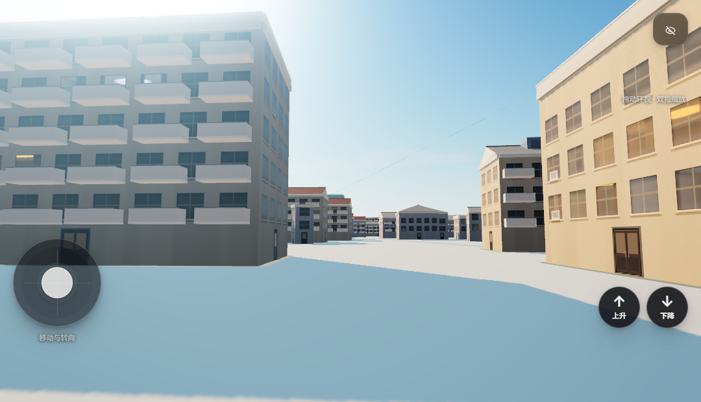
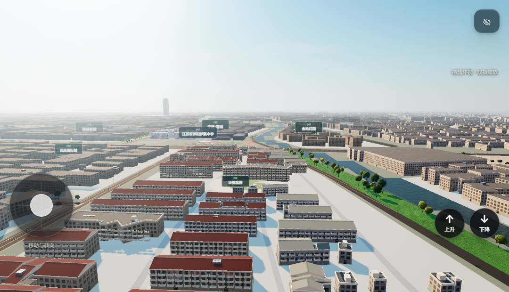
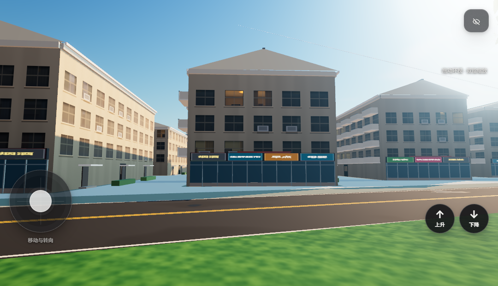
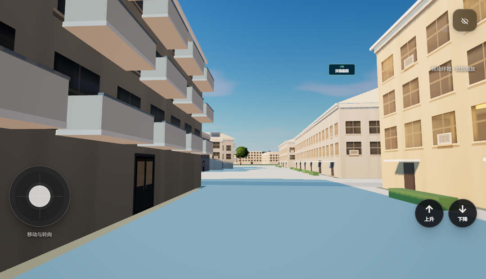

# 沃德嘉园街区建筑精细化验收

2026-11-13。按要求转向“沃德家园”一带：在既有来源轮廓上补齐住宅立面构件与临街商铺，不新增、不替换楼体。保留此前梦溪中学、实验小学、吾悦、君临、华辰各批成果。

## 本批实际变化

新增 `js/wode-district.js`，在 `js/landmarks.js` 装配阶段调用。小区范围取自 `GEO.neighborhoods` 的“沃德嘉园”多边形（别名“沃德家园”可搜索），范围内 72 条住宅来源记录中 67 条参与建体（5 条为 2–6 m 的零星附属，尺寸不足）。

| 构件 | 数量 | 依据与限制 |
| --- | ---: | --- |
| 坡屋面（分段起脊） | 47 栋 | 在线卫星图上成排板楼均为坡顶；35 栋为陶土瓦、12 栋浅灰瓦，以小区中部南北向通道为界，**不是逐栋判读** |
| 平屋顶女儿墙 | 20 栋 | 断面切不出规整矩形的小体量；只加女儿墙与压顶，不硬套坡顶 |
| 阳台（阳台板+栏板+扶手+侧板） | 1,984 组 | 南向长边逐层重复，2 单元/跑楼梯，层高按 3.0 m 折算；阳台进深、数量为类型估计 |
| 单元门+雨棚+台阶 | 268 处 | 与阳台相对的一侧，按 9.6 m 一跑楼梯；门址未实测 |
| 平屋顶设备（楼梯间/水箱/太阳能） | 20 栋 | 只放在平屋顶建筑上，位置为展示估计 |
| 临街商铺（玻璃+竖梃+店招+雨棚） | 4 处立面、14 块招牌 | 仅河滨路一侧立面确与道路相接；见下节 |
| 绿篱 | 217 段 | 楼前单元门之间的连续绿化，避开临街面与单元门 |

几何合计约 42.3 万顶点、14.1 万三角面，按材质合并为 19 个网格；未新增碰撞体，行人仍按原楼体轮廓避让。

## 关于“核心商圈”的判断

按 2026-11-13 在线卫星/标准图层与 OSM、Overture 来源记录核对，沃德嘉园**本体是住宅区**：

- 苏州西路（北）、临安东路（南）、长安路（西）三侧，来源楼体距道路中心线多在 25–60 m，中间是绿化退界或小区道路，**没有临街楼体**，因此不为这三侧虚构店面和商业裙房。
- 只有河滨路（东）一侧有 4 栋楼贴街，本批在这 4 个立面做了底层商铺与分户店招。
- 沭阳真正的人民路商圈（中央商场、蓝天商贸城）在 2 km 外；大润发在小区西北约 700 m，都不在本批范围，也没有把它们“搬”过来。

因此本批是“住宅立面精细化 + 少量真实临街商业”，不是把沃德嘉园改写成商业综合体。若需要继续，可另开一批做苏州西路西段（大润发一带）的临街商业。

## 手法

- 坡屋顶不另开体量：以最小面积外接矩形定长轴，沿长轴按 2 m 采样断面，把带凹凸的长条平面拆成若干矩形段，每段各自起脊；断面在同一位置出现两条相近进深时放弃坡顶，改女儿墙。这样屋脊不会跨过缺口，也不会把平屋顶留在长排中间。
- 瓦面用 64×64 程序纹理按 1 m × 1.4 m 平铺，檐口加浅色封檐板，屋脊加压顶，对应卫星图上每排楼最醒目的白色横线。
- 阳台、单元门、绿篱按“跑楼梯/单元”节奏排布，和 3.0 m 层高对齐；栏杆与扶手分成两种材质，避免整块白色。
- 店招为 16 个类型名（便利店、生鲜超市、药房等）共用一张图集，招牌面只改 UV；**文字是类型占位，不代表实际商户**。招牌绕向按“右×上=外法线”构造，避免文字镜像。

## 来源与精度

- 图幅：`amap-wode-rtmart-20261113`（1536×1200，GCJ-02，2026-11-13 06:05 UTC 取得），拍摄日官方未公开；查询日不等于拍摄日。
- 参考照片：高德沃德嘉园地点俯拍（B020F0IJ8D），画面无题名，身份靠地点匹配与椭圆庭院交叉核对。
- 屋面分色依据图上可见的中部通道两侧差异，属**分区判读**；单栋瓦色、坡顶高度、阳台层数与实际可能有出入。
- 未新增任何建筑来源记录：`building-audit.json` 仍为 7,728 条；本批不改 `.bin.gz` 与增强表。

## 验证结果

- `node --test tests/wode-district.test.mjs`：5 项通过，覆盖“只用小区内来源轮廓”“屋面分色分界”“阳台只在二层及以上”“所有顶点有限且在小区范围内、法线单位化”“招牌面竖直且只在临街立面”。
- 相关既有测试（`wode-mengxi`、`shiyan-campus`、`geodata`、`teleports`）14 项通过；`boot.test.cjs` 的 modulepreload 检查同样通过。
- 浏览器实测：`?debug` 载入无控制台错误；街区网格顶点范围 x 446–708、z 1706–2324、y 0–22 m，未越出小区；单帧约 217 次绘制调用、149 万三角面（航拍机位）。最大三角形面积约 400 m²（坡屋面），未出现跨尺度的大面。
- 截图：[航拍](wode-district-aerial.png)、[河滨路商铺](wode-district-shops.png)、[楼间步道](wode-district-lane.png)、[同一机位改造前](wode-district-street-before.png) / [改造后](wode-district-street-after.png)。均为本机 WebGL2 回退渲染，不作样式基准。

## 仍需核实

- 单栋是否确为坡顶、瓦色，缺逐栋判读；坡顶高度按跨度 20% 估计（1.0–2.6 m）。
- 阳台是否封闭、栏板样式、空调机位未见实拍；当前为开敞栏板。
- 单元门位置、数量与门牌未实测；绿篱走向按卫星图示意。
- 河滨路 4 处商铺的实际业态未知，店招为类型占位。
- 小区门楼、围墙、地面停车与庭院铺装仍未建模，待有具名门址资料再补。
