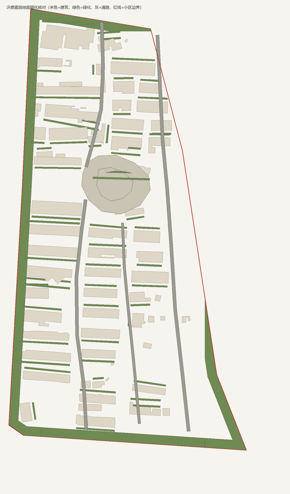

# 沃德嘉园地面细化验收

2026-11-13。按“沃德嘉园周围应该没有空地才对，需要更加细粒度的渲染”转向小区地面：在既有楼体之间补种植、边界绿化与庭院树，不新增、不替换任何建筑来源记录。

## 为什么是地面而不是补楼

用 2026-11-13 高德原生截图与项目 7,728 条来源轮廓叠加核对：小区内成排板楼的屋顶均有轮廓覆盖（见前批[沃德街区验收](../wode-district-2026-11-13/README.md)的航拍与叠加核对），没有现实楼体缺轮廓的空洞。渲染里显空的是**楼间地面**：此前只有中央庭院、4 条内部通路和楼前绿篱/铺装，其余楼间与边界仍是住宅底色大片留白。本批补的就是这层。

## 本批实际变化

| 构件 | 数量 | 依据与限制 |
| --- | ---: | --- |
| 楼间绿带 `reviewed/wode/row-green-*` | 57 条，6,653 m² | 沿 52 栋成排住宅长边外侧 3.6–6.2 m，2.6 m 宽；逐条对全部来源建筑与已写绿带做差集，保证不穿楼、不互相叠面 |
| 边界绿化退界 `reviewed/wode/perimeter-{north,south,east,west}-green` | 4 条，20,115 m² | 按小区边界向内 14 m 的环带，与四向裁切；树种、路缘与实际深度未知 |
| 庭院树 | 270 株 | 新增 `js/green-tree-sites.js` 采样器，由 `js/street-details.js` 并入既有树场；沿绿带 9 m 网格布点、避开楼体碰撞体，树种/树冠为现有行道树类型 |
| 楼前铺装/绿篱 | 沿用前批 | `js/wode-district.js` 的 1.6 m 单元门铺装与 2.4 m 绿篱带保持不变；本批绿带从其外侧 3.6 m 起，两层不重叠 |

绿化合计约 28,690 m²（占小区范围 171,182 m² 的约 17%），另有楼前铺装/绿篱按栋叠加。未新增碰撞体，行人仍按原楼体轮廓避让。

## 手法

- 绿带由 `tools/add-wode-row-greens.py` 从来源楼体的最小外接矩形长边生成，写入 `online-district-traces.json` 的 `amap-wode-rtmart-20261113` 图幅（像素坐标，管线转回米制）；`build-shuyang-urban.py` 再扣掉建筑、道路、水面与通路，绿带不会盖到这些面。
- 边界环带用 shapely `poly.difference(poly.buffer(-14))` 跟随不规则小区边界裁切，再按北/南/东/西分向，避免早期矩形版本越出边界的问题（该问题在本批自查中发现并重做）。
- 庭院树采样器是纯函数，`tests/green-tree-sites.test.mjs` 用假表面与真实 `GEO.urban.surfaces` 双向验证：树点必须落在绿面内、不落在任何来源楼体上、只认 `reviewed/wode/` 绿面。

## 来源与精度

- 图幅：`amap-wode-rtmart-20261113`（1536×1200，GCJ-02，2026-11-13 06:05 UTC 取得）；官方未公开拍摄日，查询日不等于拍摄日。
- 绿带宽度、边界环带 14 m 深度、树间距 9 m 均为展示估计；卫星上能确认“楼间有绿化/树”，不能确认树种、绿篱高度与路缘做法。
- `imageAcquired` 全部为 `null`；未把 2026 查询日当作影像拍摄日。
- 未新增任何建筑来源记录：`buildings-enriched.json.gz` 仍为 7,728 条。

## 检查

- 290 项 Node 测试中 285 项通过；5 项失败全部是既有 `overpass.test.mjs` 依赖 POSIX shell 临时文件清理的用例，Windows 上无法运行，与本批无关。本批新增 3 项绿地树木测试，`wode-district` 7 项、`wode-mengxi` 5 项相关回归通过（`wode-mengxi` 的沃德地表清单断言随新绿带更新为“4 条通路 + 4 条边界绿带 + 中央庭院/铺装”，并新增边界绿带断言）。
- 审计（`tools/audit-wode-ground.mjs`）：绿面 62 块（楼间 57 + 边界 4 + 中央庭院 1）、种植 28,690 m²、庭院树 270 株、楼体 7,728 条不变；`imageAcquired` 为 `null`。
- 平面核对图按 `online-reviewed-surfaces.json` 与来源楼体绘制，不是卫星底图，也不是浏览器截图：

## 仍需核实

1. 绿带是否与真实绿篱/花坛边界一致、树种与树冠尺寸未见逐处实拍；当前是按楼体长边的规则条带。
2. 楼间车道、地面停车位与宅前铺装图案未测绘；路面仍是统一住宅底色，只有单元门前 1.6 m 铺装。
3. 边界绿带 14 m 深度是展示估计；实际可能是绿篱、围栏或停车位混合。
4. 中央庭院以东、东南角两处小体量周边仍有较宽空白，缺可核对的铺装/绿化依据，未凭空填满。
5. 本环境未取得新的原生 3D 浏览器截图（沿用前批 WebGL2 回退截图作为形态参考）；庭院树数量、绿带渲染效果需在预览中确认。
