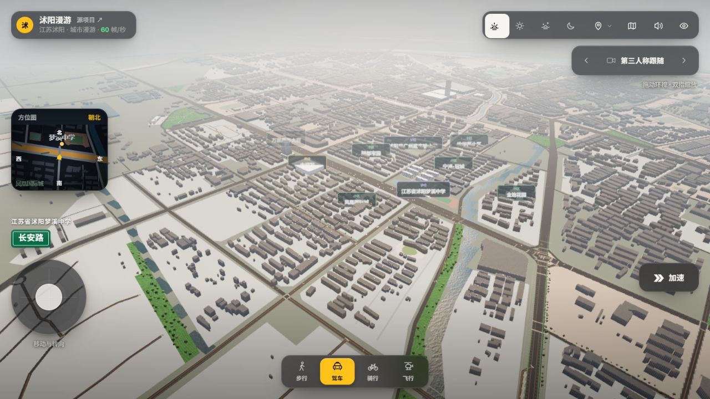
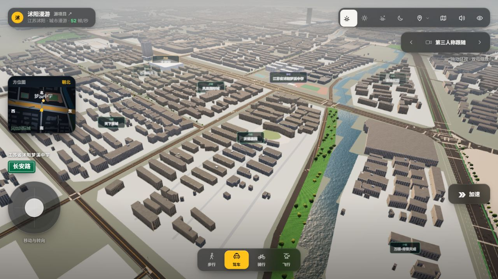
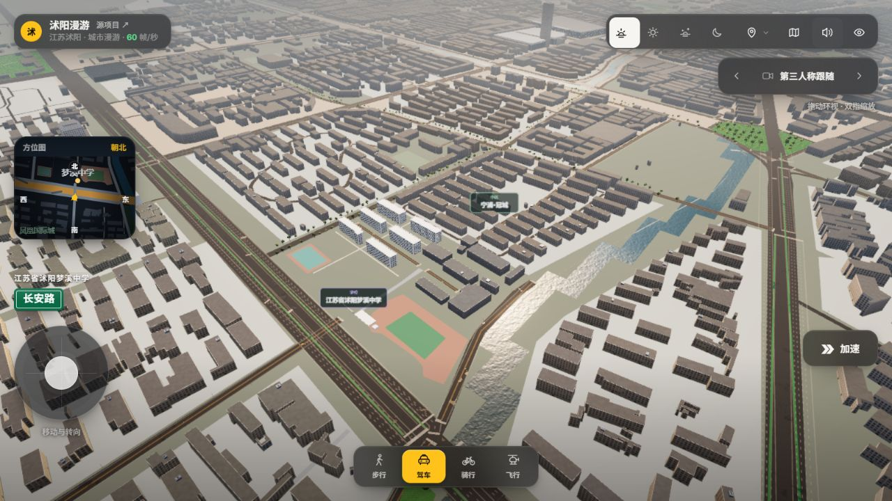

# 沃德嘉园—大润发及梦溪中学验收

2026-11-13。本批按用户要求转向整条走廊，保留前批吾悦、君临、幸福与华辰成果。

## 本批实际变化

核对高德官方标准图和卫星图覆盖范围中的186处完整楼体轮廓，151处已有来源覆盖。35处候选进入几何融合，34处接纳；天下景城一处与原Overture轮廓重叠超过阈值，保留原记录，未强制叠楼。

| 范围 | 新增建筑记录 | 当前关联记录 | 额外处理 |
| --- | ---: | ---: | --- |
| 沃德嘉园 | 11 | 72 | 浅黄灰多层住宅类型配色、中央椭圆庭院绿地与铺装、4段可见内部通路；“沃德家园”别名搜索 |
| 天下景城 | 17 | 59 | 具名入口照片参考，门址未绑定 |
| 苏通花苑 | 4 | 36 | 浅黄色多层住宅类型配色、具名入口照片参考 |
| 颖都家园 | 2 | 72 | 具名入口照片参考 |
| 凤凰国际城 | 0 | 41 | 保留已有来源楼体与入口模型；本批未发现可安全加入的完整无冲突轮廓 |

大润发保留已有来源轮廓和历史照片模型，未将住宅轮廓套到商场，也没有把2009年外观重新标成2026现状。

梦溪中学按苏州西路3号、高德B0FFIJI7DY核对，与瑞声大道梦溪实验学校区分：

- 院区近似边界内保留15条来源记录；六个西侧教学翼明确绑定专用模型，其余9条继续普通渲染，未挖空整校。
- 六翼白灰窗带、屋顶开放框架参考庭院实拍。21.6米含框架、19.8米主体均为类型估计；原9至12米左右CNBH值保留在`previousHeightReference`，不伪称新测量或官方楼层数据。
- 石材校名墙、东侧钢架雨棚和警务室沿卫星可见中轴近似放置，中央入口保持开放；校门尺寸未实测。照片中的临时考试横幅未建成永久设施。
- 前部东侧红色运动铺装保留绿色内场孔洞，西侧球场区保持地图形状，另补中轴通路。两条旧通用运动场面由明确绑定的地表替换，未双重盖面；项目类型和道数不据模糊影像推定。
- 加入第20处可传送地标及两张原作者照片参考。

## 来源和精度

凭用户授权临时访问高德JS API。原生地图画面1536×1300，地图区域1536×1200、顶部偏移100；GCJ-02逆转换至WGS84，再转本项目米制坐标。该批独立参考ID为`amap-wode-rtmart-20261113`，未复用吾悦/君临图幅的投影参数。

查询时间2026-11-13 06:05:33 UTC。影像拍摄日未披露，查询日不能当作拍摄日。入口照片横幅可读“2026年初中学业水平考试……梦溪中学考点”，只记录图内事件信息，不反推拍摄日。

公开来源：[梦溪中学](https://www.amap.com/place/B0FFIJI7DY)、[沃德嘉园](https://www.amap.com/place/B020F0IJ8D)、[颖都家园](https://www.amap.com/place/B020F0IKNY)、[天下景城](https://www.amap.com/place/B020F14YNK)、[苏通花苑](https://www.amap.com/place/B020F0IJ7U)。照片署名高德地点照片原作者，远程原图用于参考面板，未分发为建筑贴图。

沃德庭院照片未见小区题名，身份依据为地点匹配和椭圆庭院布局交叉核对，界面单独说明。四个新增照片范围都未放置未经定位的小区实体门楼。普通住宅配色只应用于12至27米住宅/房屋类型，不影响高层、厂房和办公楼。

## 验证结果

- 262项Node测试通过，包括五项新增走廊/校园回归；既有7项POSIX shell专用Overpass测试未在Windows运行。2项Python中文编码测试通过。
- 最终浏览器加载7,728条来源、7,697条普通楼体；30条明确绑定专用模型，1条完全覆盖，13条部分裁剪，裁剪失败0。原7,558条OSM/Overture来源和前批136条补录均保留。
- 40个楼顶探针全部命中实际楼体几何，包括本批34条新增和6个教学翼；11个地表探针全部命中对应地表；20处汽车传送均干燥、无来源建筑占用。
- 手机375×667：页面宽375，无横向溢出；小地图、持续加速与出行切换均在视口内，加速开关已往返验证并恢复关闭。
- 梦溪两图及四个新增小区首图共6张在实际浏览器加载成功；照片面板无横向溢出。长说明在手机面板内纵向滚动。
- 正常加载控制台错误0；测试相机覆盖、禁用缓存和视口尺寸均已恢复，保留正常梦溪中学传送落点供用户预览。临时地图页已关闭，8124核对代理已停止；8123本地预览继续运行。凭据未写入项目数据或文档。

证据：[运行时审计](runtime-audit.json)、[测试](node-tests.txt)、[手机界面](mobile-hud.json)、[照片检查](mobile-gallery.json)。

## 仍需核实

本批补齐可确认缺楼并改善校园识别，尚未逐栋还原外立面、坡顶、阳台和院内植被。普通楼栋高度多数仍来自2020栅格或估算，新增住宅暂按18米展示；照片与各栋楼的精确对应仍不足。天下景城冲突候选继续保留在审计中，未认定该处完整轮廓已经恢复。梦溪校园红线、门址尺寸、东侧楼体高度和连廊精确结构未测绘，不用规则生成体块补空。
