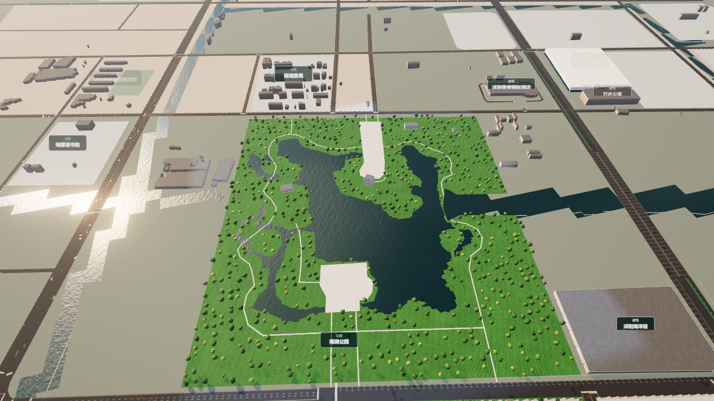
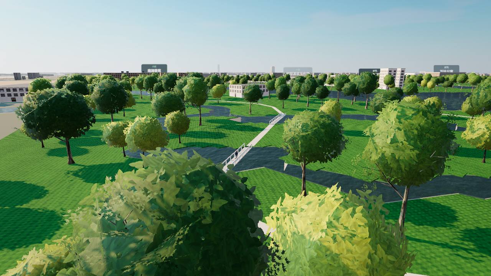
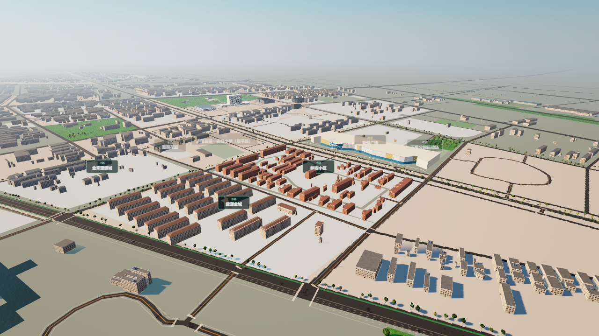
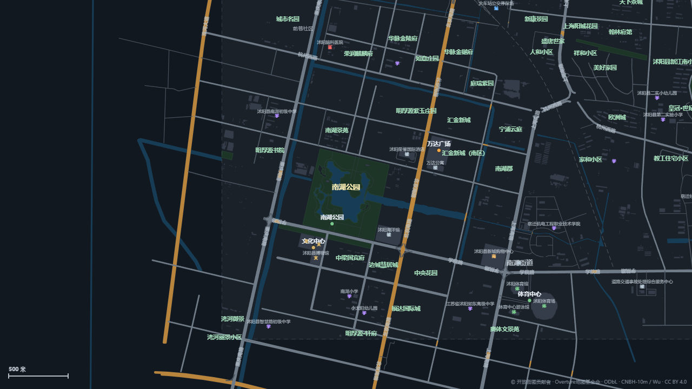

# 吾悦周边与公园补充验收

本批是持续还原的一部分，**未完成最新城区逐栋复原**。当前7,603条建筑来源记录、143个小区和18处可传送地标；大润发、吾悦广场、沭阳高级中学保留在传送菜单中。

## 本批变化

- 吾悦周边补录45条经影像逐个核对的近似屋顶轮廓：盛源金城23、临安小区9、阳光天地南部13。72处候选中27处因与已有来源重叠而未重复添加；保留原有7,558条建筑记录。
- 新增盛源金城、临安小区中文导航标注与近似范围。实拍仅确认多层住宅类型，浅米/橘红白配色只用于相应高度与用途，不给未核对的塔楼、厂房和办公楼套用。四坡屋顶生成真实斜面，屋脊保持在来源展示总高度内。
- 老虞姬公园（公园路19号、城北公园）新增独立传送。它与迎宾大道虞姬生态园、南湖内虞姬园分开；未定位纪念塔不随意放置。
- 高中补入来源运动场地，并增加2025年公开大礼堂实拍参考；23条源校园楼体保持。礼堂与单一楼体的对应尚未确认。
- 南湖按2021-12-10影像补录约91,977平方米近似水面，保留西侧岛屿和中央半岛，两处广场按可见铺地轮廓补入。四座地图步行桥生成可通行桥面；高程和栏杆样式仍是展示估计。
- 水系内孔贯穿3D地面、草坪、地图、河岸和通行判断。南湖局部用矢量陆地减水面替代30米地面格子。树木不再生成在水面、已标广场和运动场中；移除未定位的南湖通用亭桥、展馆和雕像。
- 二进制建筑按内容哈希请求并验证实际解压内容，拒绝旧建筑数据配新索引，避免缓存导致缺楼或错替换。高德凭据未写入文件，本批未使用凭据进行请求。

## 运行画面

以下图像直接读取实际浏览器已渲染的WebGPU/地图画布，包含场景与3D导航文字，**不包含DOM工具栏和对话框**。原生整页截图接口失败，因此不称为完整页面截图验收。没有把手绘示意图当作运行画面。

南湖整体岸线：

西侧来源步行桥与桥下水道：

吾悦片区当前楼群（右侧及远处仍有来源缺楼，不裁掉缺口）：

同源街道图中的南湖水面和岛屿：

## 检查结果

| 检查 | 结果 |
| --- | --- |
| Node回归 | 253通过；Windows不运行既有7项POSIX shell专用Overpass测试 |
| Python中文编码回归 | 2通过 |
| 来源建筑 / 普通渲染 | 7,603 / 7,583 |
| 专用替换 / 完全覆盖 / 部分裁剪 | 19 / 1 / 13；裁剪失败0 |
| 18处汽车传送 | 全部找到干燥落点，安全解析器同时检查完整车体碰撞 |
| 4处桥心 | 均在水道内；步行/骑行地面0.38米，汽车不允许进入 |
| 公园树点 | 3,761；水面内0、广场内0 |
| 建筑与新增铺装相交 | 最大0平方米 |
| 375×667手机布局 | 无横向溢出，小地图/加速/出行切换/照片面板均在屏内；加速开关可切换 |
| 1280×720桌面布局 | 无横向溢出，小地图/加速/出行切换均在屏内；南湖地图搜索和外部核对链接正常 |
| 实景面板 | 18地标、143小区、9个具名实拍、127个有候选图片；新小区近似范围与门址待定位说明存在 |
| 浏览器控制台 | 最终检查无error；后台帧率未作为性能指标 |

运行来源与落点详见[runtime-audit.json](runtime-audit.json)，手机DOM尺寸见[mobile-layout.json](mobile-layout.json)，桌面见[desktop-layout.json](desktop-layout.json)。[node-tests.txt](node-tests.txt)、[urban-audit-output.json](urban-audit-output.json)、[geodata-build.txt](geodata-build.txt)保留本批结果。`building-coverage-output.txt`是离线候选/模型交集诊断，不作为普通楼体实际损失数；普通渲染以运行时审计为准。

## 来源日期和未完成部分

- [吾悦实拍研究](../../../tools/data/shuyang/wuyue-district-photo-research.md)、[公园与高中内部研究](../../../tools/data/shuyang/park-school-interior-photo-research.md)保留原始来源、看过的图片和不能确认的位置。
- 吾悦影像实际拍摄2021-01-29；南湖影像2021-12-10。两份逐点metadata保留在数据目录，Esri服务发布版本2026.R05不是拍摄年份。提供方分辨率约0.46米、位置精度约5米，树荫下水道和屋顶地面位置仍有人工判读误差。
- Overture发布2026-10-21.0；OSM建筑本地快照2026-11-11、用地已刷新至2026-11-12 UTC。数据发布日期不证明全部新楼已收录；5,271条建筑仍用2020 CNBH估高。
- 嘉瑞·玫瑰园、碧桂园、幸福家园、君临天下等楼群仍有明显缺口。134个小区尚未核对具名实拍，5个已有照片的小区仍需定位门址。南湖花瓣平台和园内建筑、老公园塔桥、高中礼堂的精确对应仍未完成。
- 影像原图保存在忽略的研究目录，未作为外墙纹理分发；公共照片保留作者署名和来源链接。外部图片可能受原站加载限制，可打开原始来源查看。

后续继续按[持续还原进度](../../BUILDING_REFINEMENT_PROGRESS.md)补齐，不能以本批测试通过认定目标完成。
