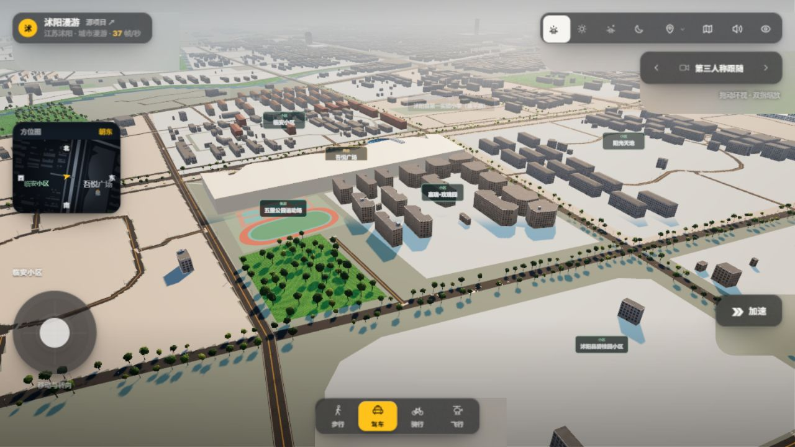
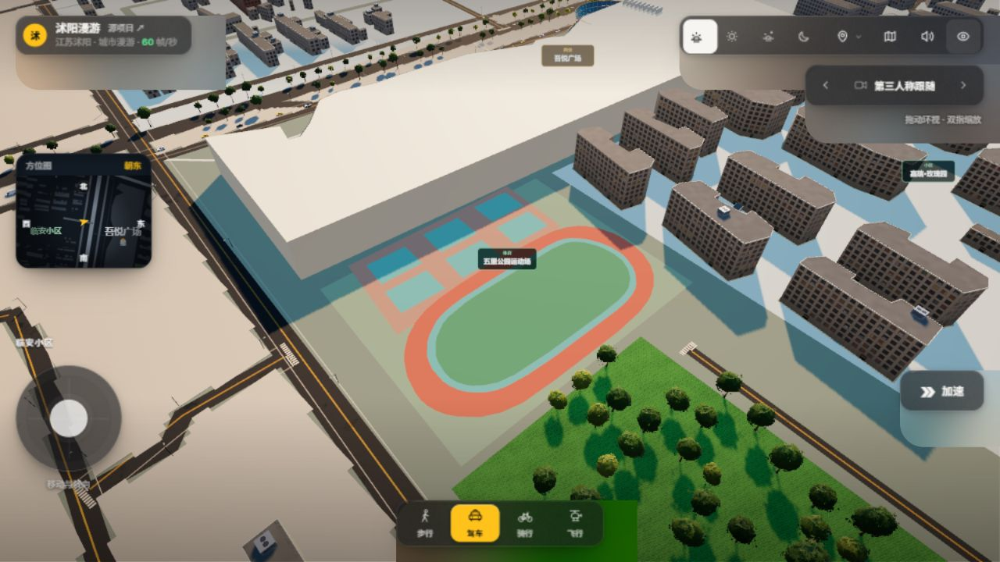
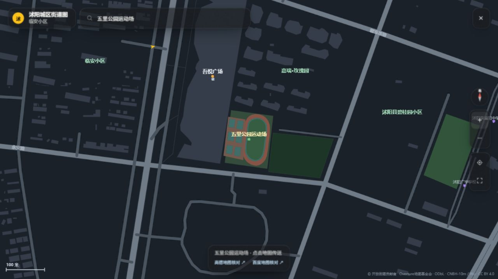
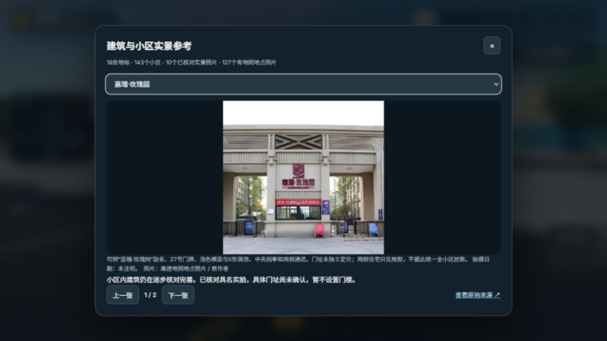

# 嘉瑞·玫瑰园与五里运动场补充验收

日期2026-11-13，接续[吾悦与南湖批次](../wuyue-district-2026-11-13/README.md)。本批新增16条近似楼体和运动场内部地表，**全城最新建筑与街道还原仍未完成**。

## 已落地

- 嘉瑞·玫瑰园：18处单独叠图核对的多顶点屋顶候选，16处进入生成结果，2处与旧小轮廓冲突而保留旧数据。五处东侧遮挡候选继续延后，不按规则网格补楼。原有7,558条记录及前批45条补录全部保留，累计7,619条、影像补录61条。
- 当前普通楼体实际7,599条：明确专用模型替换19条、完全覆盖1条、部分裁剪13条、裁剪失败0。嘉瑞关联19条源记录，**不代表已确认完整栋数**。
- 嘉瑞具名入口实拍纳入参考面板：可辨小区题名、27号门牌、浅色平梁/X形装饰、岗亭与两侧通道。日期和准确门址未知，不放置猜测门楼，不由局部住宅统一全区层数。累计10个小区已核对具名实拍、4处入口/景石模型。
- 五里公园运动场：按同幅影像补入平滑环形跑道、绿色内场、内场边缘、6块矩形球场及其周边铺地，共10个地表几何；地图与3D共用同一外环和内孔。原始像素保留，曲边作一致的两遍圆滑插值。球类项目、道数、现状标准尺寸未知，不补虚构篮架、足球线或跑道道数线。
- namedSites依据OSM的pitch/track等标签正确归类为“体育”，不把运动场标成普通建筑。地表从建筑、道路、水面与已有步道中扣除。
- 逐个补录接受/拒绝决策增加来源ID、面积与交集，后续能够继续处理小轮廓阻挡完整屋顶的冲突，不把去重等同于已还原。

## 实际画面

本批原生浏览器截图接口恢复。以下JPEG为含工具栏和方位图的**完整页面截图**；另外PNG文件是直接读取实际渲染画布，清晰但不含DOM工具栏。没有用手绘图替代运行画面。

桌面实拍面板：

手机截图分别保存在[实拍面板](rose-garden-gallery-mobile.jpg)和[场景](mobile-scene.jpg)；面板内容较长时内部纵向滚动，无横向溢出。原始影像和叠线核对图只在忽略目录/Temp用于研究，不作为纹理分发。

## 检查

- 255项Node测试通过；Windows未运行既有7项POSIX shell专用Overpass测试。2项Python中文编码测试通过。见[node-tests.txt](node-tests.txt)、[python-tests.txt](python-tests.txt)。
- 16处新增楼体逐一对实际SurveyedBuildingChunk做向下射线：均命中对应24.22米屋顶（24米展示高加0.22米地面偏移），且详情/碰撞轮廓存在。**24米是展示估高，不是测绘结果**。
- 跑道、内场、球场、边缘和球场周边铺地分别射线命中实际对应网格；跑道内孔没有用红色盖满内场。18处汽车传送仍均找到干燥、全车体碰撞检查通过的落点。
- 当前143小区关联3,086条记录，铺装与楼体最大交叠0平方米；名称、来源索引与压缩文件SHA一致。见[urban-audit.json](urban-audit.json)。
- 手机375×667核对小地图、加速、出行切换均在屏内；嘉瑞实拍已实际加载，参考面板无横向溢出。见[mobile-hud.json](mobile-hud.json)、[mobile-gallery.json](mobile-gallery.json)。
- 最终浏览器控制台error为0；临时相机与测试视口均恢复。后台帧率未作为性能测量。

逐项运行结果见[runtime-audit.json](runtime-audit.json)。[geodata-build.txt](geodata-build.txt)记录7,619来源、7,622地图部件及143小区的数据生成情况。

## 日期与尚未完成

- 本批实际采用2021-01-29的Esri/Vantor影像，不是2026现状。高德地点页加载超时，2024航拍公开预览403，其他同名/未验证图均未充当更新证据；详情见[来源核对](source-review.md)。
- 新增16条仅补近似几何，24米高度、平屋顶与住宅材质均为展示估计。屋顶倾斜投影、影像位置精度和阴影限制其地面准确性，不宣称逐栋拟真已完成。
- 嘉瑞5处遮挡轮廓、2处旧数据冲突、内部道路和景观尚待核实；幸福家园、君临天下、碧桂园等处仍有明显缺楼。133个小区尚未核对具名实拍，6个已有照片的小区仍未定位门址。
- 虞姬公园塔桥、南湖花瓣平台及园内建筑、高中礼堂与楼体对应等上一批列出的缺口继续保留。不能用本批测试或画面认定全目标完成。

后续工作继续按[完整进度](../../BUILDING_REFINEMENT_PROGRESS.md)推进。
